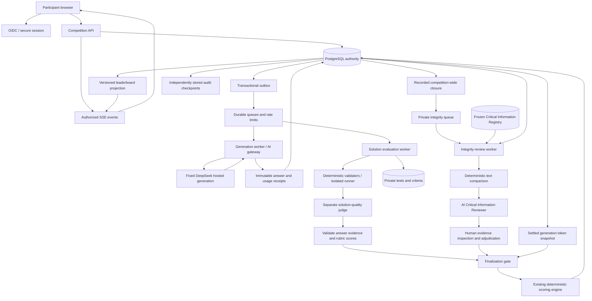
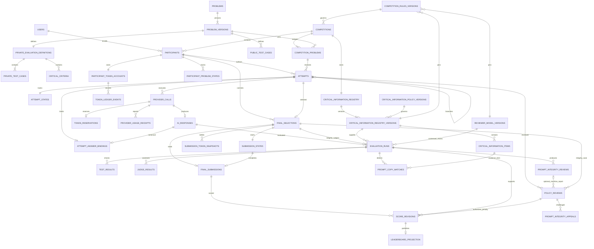
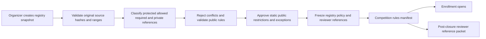
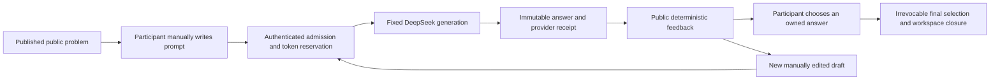
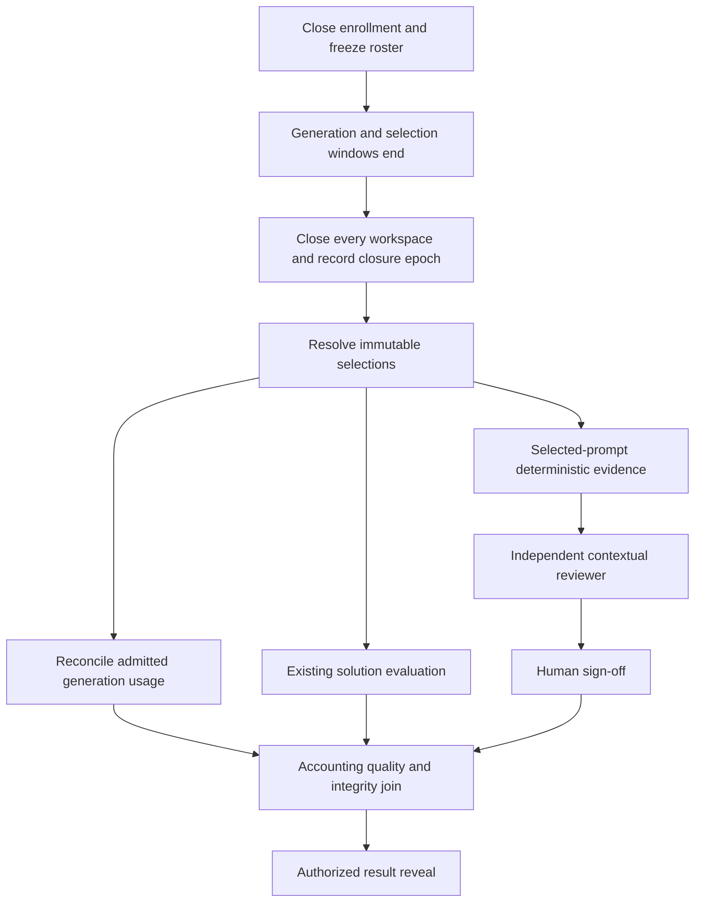
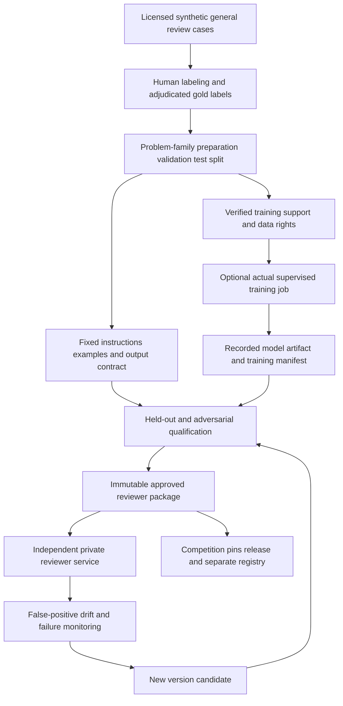
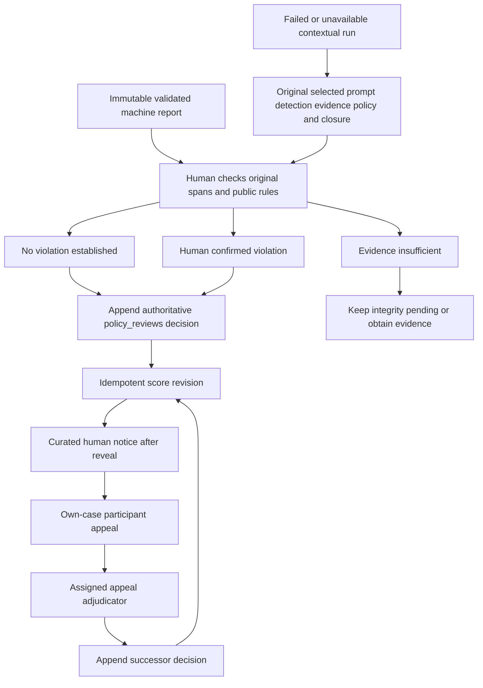
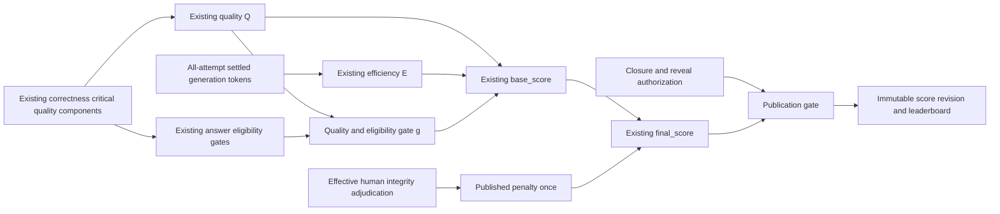
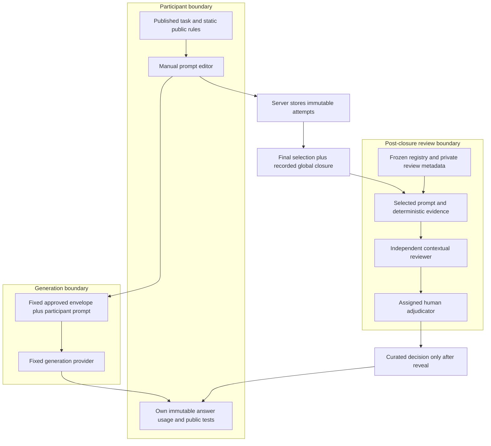

# AI Prompt Battle: system architecture with AI Critical Information Reviewer

**Current implementation, 22 November 2026 (Asia/Dhaka):** the local application is implemented. New competitions use automatic copying decisions, append-only problem revisions and earliest fully correct completion to break equal scores. Section 28 records these later approved rules and takes precedence over the original human-sign-off and draft-only design below. Older published competitions retain their recorded policy. The local application opens at http://localhost:3100. Provider qualification and independent reviewer benchmarking remain separate from functional verification.

Design date: 14 November 2026, Asia/Dhaka. Revision: 2, documentation-only Critical Information Reviewer upgrade. Status: system design; no application implementation, reviewer training, calibration or model qualification has been performed by this document revision.

This design follows the supplied competition brief and the user's confirmed choices. It treats the server, database and provider evidence as the authority. Participant browsers are untrusted.

The fixed generation connection is DeepSeek's hosted API, or an explicitly configured qualified alternative under the same competition rules. The AI Critical Information Reviewer is a separate, reusable instruction-prepared model package; it is independent of both generation and solution-quality judging. "Pretrained" refers to an externally supplied base model. "Prepared" describes the versioned instructions, examples and benchmarks to be assembled and validated, not weight training that has already occurred. Sections 19-25 specify the upgrade and its change log; sections 1-18 retain the existing platform architecture.

## 1. Decisions, ambiguities and loopholes

### Confirmed decisions

| Decision | Initial competition rule |
|---|---|
| Competition size | At most 10 enrolled participants |
| Problems | Immutable problem revision per attempt; organizers may append later revisions |
| Allowance | 2,000,000 generation tokens per participant across the entire competition |
| Generation access | The same fixed model revision and generation settings for everyone |
| Copying public facts | Required facts, names, values, constraints and output keys may be reused |
| Prohibited passages | Only passages explicitly designated by public rules can incur a copying penalty, after review |
| Answers | Generated answers and accepted historical prompts are immutable |
| Final selection | One irrevocable selection of an owned attempt with a complete immutable answer; usage may still be pending |
| Prompt authoring | Participants manually author every prompt; no AI prompt generator, optimizer or writing assistant |
| Integrity review timing | Deterministic detection and contextual AI review start only after competition-wide closure |
| Reviewer first release | Independently qualified instruction-tuned base model with a reusable prepared review package |
| Confirmation authority | New rounds use supported automatic AI decisions and server-mapped published deductions; legacy rounds retain human sign-off |
| Active integrity feedback | No copy warnings, match information, confidence, reviewer hints or writing suggestions during competition |

### Proposed defaults that must be frozen before enrollment

These are design defaults, not additional user confirmations.

1. **Generation context:** each attempt is standalone. The generator receives a fixed, published system envelope plus the participant's prompt. The public statement is displayed to the participant but is not automatically added to the provider request. Participants may include all necessary public facts. If the organizer instead supplies public problem context automatically, that context must be identical for everyone, disclosed, versioned and charged as input. Hidden tests and criteria never enter generation context.
2. **Tools:** initial competitions are text-only, with no autonomous browsing, retrieval, function calls or external model access through the platform. Explicitly permitted external assistance is a competition-rule decision. A browser platform cannot prove that a participant did not consult another device or service.
3. **Failures:** all provider-reported generation usage counts, including billed failed calls. Undo, abandoned attempts and selecting an earlier answer do not refund consumption. Evaluation and judge calls are paid from a separate organizer account.
4. **Feedback:** practice reveals factual public deterministic test results and their safe explanations. No participant-facing AI writing assistance or integrity feedback is available. Hidden results stay sealed until enrollment is closed, the roster is frozen and every enrolled workspace is irreversibly closed to new generation and final selection. Integrity detection cannot start before the final-selection window closes and this closure is recorded. The official leaderboard then updates live as fully finalized scores are published at the permitted reveal time.
5. **Deadlines:** publish an enrollment window, generation-admission cutoff, final-selection cutoff and result-reveal time. Jobs admitted before the generation cutoff may finish during a published grace period. A selection accepted before its cutoff may continue settling and evaluating afterward. A pending provider bill is not converted into a fabricated token count.
6. **Unavailable participants:** no automatic final selection by default. The user must submit an attempt before the selection cutoff. If auto-selection is desired, publish its exact deterministic rule before the competition.
7. **Scores:** publish scoring weights, efficiency reference, indispensable requirements, penalty schedule, tie rules and appeals process before opening. Keep the private test contents and private scoring evidence confidential.
8. **Timing:** no latency bonus is added to the score. New rounds use earliest fully correct server completion only to break equal final scores; section 28 defines the pinned-version evidence and ordering.
9. **Copying scope:** review only the participant-authored prompt bound to the selected final answer. Drafts, platform envelopes and unselected attempts are outside integrity enforcement; all generation attempts still count toward usage.
10. **Registry:** every competition pins an organizer-approved Critical Information Registry and policy before enrollment. Necessary facts are reusable. Protection must be explicitly published, not inferred by an AI.

### Important limits and their architectural consequences

| Ambiguity or loophole | Consequence and design response |
|---|---|
| “Did the participant genuinely reason?” | Neither copied text nor an AI judge can establish a person's internal reasoning. Assess observable output, explicit rule compliance and resource use. |
| “Critical information” | Classify protected passages, allowed public information, required information and private evaluation references separately. Answer-critical criteria and prompt-use restrictions are different dimensions. |
| Only the chosen attempt is charged | Enables unlimited expensive exploration followed by a cheap selected answer. Count all generation usage. |
| Hidden feedback after each attempt | Creates an oracle for discovering hidden criteria. Seal private evaluation until participants can no longer adapt. |
| Streaming usage is missing | A closed browser is not proof of zero usage. Retain reservations and reconcile provider evidence. |
| Exactly-once provider calls | Database transactions cannot atomically commit a remote model call. Require provider idempotency/recovery or hold ambiguous calls without blind retries. |
| A rough tokenizer is sufficient | It cannot prove a strict cap. Require exact counting or a defensible upper bound for the complete supported request format. |
| Any output can pass arbitrary hidden inputs | A fixed JSON answer can be checked against its task instance; a generated program can run against different inputs. A prose answer cannot automatically be treated as an executable algorithm. Define a problem-type validator. |
| Temperature zero guarantees replay | Hosted generation and judges may still vary. Preserve artifacts and judgments to reproduce the recorded calculation, rather than promise identical regenerated text. |
| Hashes prove no administrator tampered | An administrator can rewrite data and local hashes. Independently stored signed checkpoints make this more detectable. |
| AI says a copy is confirmed | Machine reports cannot confirm guilt or authorize penalties. Every final prompt receives human sign-off; potentially penalizable and uncertain findings always require adjudication. |
| Earlier prompts contained protected material | Final-prompt-only review does not establish compliance of unselected attempts. Do not imply otherwise or silently broaden enforcement. |
| Important facts are automatically protected | Registry publication rejects protection of required/allowed facts without a precise compatible partition and exception. Private criteria are never secret copying rules. |
| A prepared model is called platform-trained | Instructions and benchmarks are preparation. Actual fine-tuning requires verified support, a training-job record, dataset provenance and a resulting artifact. |

## 2. Recommended system and technology stack

Use a modular backend with separate workers, rather than ten small microservices. PostgreSQL is the source of truth; queues and leaderboard caches are projections or delivery mechanisms.

| Layer | Recommendation | Responsibility |
|---|---|---|
| Web interface | Next.js, React, TypeScript; Monaco or a plain text editor | Competition workspace, read-only answers, history, balances, leaderboard |
| Backend | NestJS with TypeScript on a supported Node.js LTS | Auth, access checks, workflows, versioned contracts, token admission and score calculation |
| Authentication | Established OIDC identity provider | Login, secure sessions; MFA for organizers |
| Database | Managed PostgreSQL | Constraints, transactions, row locking, immutable records and balance projections |
| Queue and rate limits | Redis and BullMQ, backed by a transactional PostgreSQL outbox | Generation/evaluation delivery, backpressure, distributed rate limits |
| Artifact storage | Private S3-compatible storage with versioning; retention/object lock where supported | Large responses, provider receipts, private test artifacts, audit checkpoints |
| AI integration | Server-only provider adapters | Pinned model configuration, bounded requests, usage normalization and recovery |
| Deterministic checks | Problem-specific typed validators | Structured outputs and public/private assertions |
| Prompt integrity matching | Versioned server-side comparison module | Exact, normalized and partial protected-text evidence with original-byte mappings |
| AI Critical Information Reviewer | Independent instruction-prepared model package and reviewer worker | Post-competition contextual integrity assessment; no participant writing or score authority |
| Human adjudication | Organizer/reviewer interface and existing `policy_reviews` | Evidence inspection, authoritative decisions and appeals |
| Generated-code runner | Dedicated hardened sandbox service, preferably microVMs | Execute untrusted code under resource and network isolation |
| Observability | OpenTelemetry, metrics, centralized redacted logs and alerts | Queue health, provider incidents, accounting integrity and judge drift |

Do not choose a model only by general reputation. Qualify one generation configuration and one separate judge configuration against the actual problems. Require a pinned revision or an explicit provider revision contract. A model alias that can silently change is unsuitable for a reproducibility claim without a declared migration policy.

An initial deployment can contain one API service, one generation-worker service, one solution-evaluation-worker service, one integrity-review-worker entrypoint, PostgreSQL, Redis and private storage. Add the isolated runner only for code problems. The API and workers share domain modules but use different database roles and secrets. DeepSeek generation is hosted; this revision does not require a local generation GPU. The integrity worker uses a separate approved reviewer model configuration, queue and credentials. The existing OIDC, local-first deployment and cloud scaling choices are retained.

### High-level architecture



Provider keys, hidden criteria, private registry metadata and raw judge/reviewer records are never delivered to participant browsers. The generation worker cannot read private evaluation or reviewer data. No route connects integrity evidence back to the generation context. The finalization gate requires accounting, solution evaluation, resolved integrity adjudication and the disclosure gate.

### Backend module boundaries

- **Identity and access:** sessions, roles, participant ownership and organizer permissions.
- **Competitions:** capacity, deadlines, enrollment and immutable rule manifests.
- **Problem registry:** public statements, private criteria, validator packages and version publication.
- **Critical Information Registry:** organizer classifications, public reuse rules, private metadata and immutable competition-specific versions.
- **Attempts:** immutable prompt versions, branches, operational status and immutable answers.
- **AI gateway:** generation envelopes, model adapters, provider-call records and dispatch recovery.
- **Token accounting:** reservations, receipts, cost estimates, settlements and reconciliation.
- **Solution evaluation:** public practice checks, private final checks and quality-judge validation; it does not decide prompt integrity.
- **Prompt integrity:** post-closure deterministic evidence, independent AI contextual review, human adjudication and appeals; it does not grade solution quality.
- **Scoring:** versioned formulas, eligibility, penalties and immutable score revisions.
- **Submissions:** irrevocable final selection, sealing and budget snapshot creation.
- **Leaderboard:** eligible published scores, deterministic ranking and event revisions.
- **Audit and operations:** append-only events, redacted logs, incident response and evidence exports.

## 3. Database architecture

Use UUID primary keys, UTC `timestamptz` timestamps, `BIGINT` token quantities, and decimal or integer monetary units. Convert timestamps to Asia/Dhaka in the interface when appropriate. Persist immutable identifiers and policy versions with every outcome.

### Entities

| Table/entity | Essential fields and relationships |
|---|---|
| `users` | Identity-provider subject, display alias, account status; no locally managed passwords by default |
| `competition_roles` | User, competition, organizer/reviewer/participant role; separate least-privilege reviewer access |
| `competitions` | Capacity, lifecycle, deadlines, frozen `rules_version_id` |
| `competition_rules_versions` | Model/settings/envelope digest, budget scope, feedback policy, scoring formula, reference tokens, penalty rules, judge configuration and manifest digest; also pins registry, integrity policy, reviewer release, matcher/schema versions and review-cohort policy |
| `participants` | Competition, user, enrollment status; unique `(competition_id, user_id)` |
| `problems` | Stable catalog identity, owner and problem type |
| `problem_versions` | Immutable public statement, objectives, public constraints, output contract and public examples |
| `competition_problems` | Competition and pinned problem version; initial policy permits exactly one |
| `private_evaluation_definitions` | Evaluator-only rubric, critical-criteria set, test-suite and runner digests; linked to a frozen problem version |
| `public_test_cases` | Public assertions/fixtures and weights available for practice feedback |
| `private_test_cases` | Private fixtures/assertions, weights and indispensable-test flags; evaluator-only |
| `critical_criteria` | Criterion ID, private definition, checker type, weight and eligibility rule; versioned and evaluator-only |
| `participant_problem_states` | Participant and competition problem; `OPEN`, `FINALIZING`, `FINALIZED`, `NO_SUBMISSION`; unique pair |
| `prompt_drafts` | Optional mutable workspace convenience; never authoritative for accepted attempts or scoring |
| `attempts` | Participant, competition problem, owned parent attempt, version number, immutable prompt, prompt hash, rules version and admission time |
| `attempt_states` | Separate mutable generation, accounting and practice-evaluation projections; histories live in append-only state events |
| `provider_calls` | Every physical generation, quality-judge or integrity-review execution; checked purpose and participant/organizer payer; attempt/evaluation reference, request ID, dispatch key, request digest, model revision and call state |
| `ai_responses` | Immutable answer bytes or private object reference, answer hash, provider call and output-format metadata; selected answer identity is stable |
| `attempt_answer_bindings` | Immutable unique attempt-to-canonical-response binding; response's call must belong to that attempt; no answer replacement |
| `participant_token_accounts` | Participant, allowance, confirmed consumed tokens, held reservations, account state and projection revision |
| `token_reservations` | Physical generation call, reserved upper bound and mutable projected hold state |
| `token_ledger_events` | Append-only reservation, settlement, release and correction deltas; call/receipt references and ledger sequence |
| `provider_usage_receipts` | Original usage metadata, normalized input/output/total, cache/reasoning details, provider request ID, receipt hash and recovery evidence |
| `pricing_versions` | Provider/model, currency, input/cached-input/output rates and effective date; copied/reference-pinned per cost record |
| `evaluation_runs` | Existing solution-run envelope plus typed `CRITICAL_MATCH` and `CRITICAL_CONTEXT_REVIEW` runs; exact selected prompt/answer references as applicable, parent run, closure proof, pinned versions and immutable input digest |
| `test_results` | Run, test ID, pass/fail/runner-error, weight and private evidence reference |
| `judge_results` | Run, judge configuration, typed rubric scores, cited answer evidence, validity status and raw private receipt |
| `policy_reviews` | Canonical append-only human adjudication; integrity report/evidence, public policy version, actor, decision, penalty, predecessor and appeal references; machine reports cannot populate authoritative decisions |
| `final_selections` | Immutable owned attempt and response identity, participant/problem and accepted timestamp; unique participant/problem |
| `submission_token_snapshots` | Immutable initial or explicitly corrected snapshot, final selection, predecessor snapshot, ledger boundary, cumulative confirmed generation usage and accounting provenance |
| `final_submissions` | Immutable sealed references to selection, answer, rules and token snapshot; exactly one per participant/problem |
| `submission_states` | Stable submission-workflow ID created with final selection; mutable sealing/evaluation/publication projection; references selection immediately and sealed artifact later |
| `score_revisions` | Submission, evaluation, token snapshot, policy review, normalized components, formula version, full precision result and publication revision |
| `leaderboard_projection` | Competition, published score revision, alias, eligibility and ranking fields; rebuildable |
| `audit_events`, `outbox_events` | Actor/request/state evidence and transactional delivery records; operational delivery state may be mutable |
| `critical_information_registry` | Stable UUID and unique competition FK; organizer ownership |
| `critical_information_registry_versions` | Immutable source/problem-bound snapshots, sequence/predecessor, policy FK and content/public-policy digests |
| `critical_information_items` | Versioned stable item keys, source ranges, category, protection status, reuse/exception rules and severity |
| `critical_information_policy_versions` | Competition-specific integrity rules and references to the authoritative published penalty schedule |
| `reviewer_model_versions` | Reusable model/preparation package, template/schema/matcher versions, provider revision contract, provenance and qualification records |
| `prompt_copy_matches` | Immutable candidate evidence, source/prompt hashes and ranges, transformations, original-offset mapping and metrics |
| `prompt_integrity_reviews` | Validated machine findings bound to exact selected prompt, detection/context runs and frozen registry/policy/reviewer versions |
| `prompt_integrity_appeals` | Own-submission appeal requests; resolution appends a `policy_reviews` decision |
| Typed internal projections | `prompt_copy_detection_runs` and `reviewer_evaluation_runs` project typed `evaluation_runs`; `prompt_integrity_adjudications` projects human `policy_reviews`; no duplicate authoritative tables |

Historical prompts do not need both a mutable `prompts` table and a mutable `prompt_versions` table. Each accepted `attempt` is the immutable prompt version. A local draft is a separate convenience object. Each response version belongs to a provider execution; a generated alternative is a new attempt, never an overwrite.

### ER diagram



Generation `provider_calls` require an attempt; quality-judge and integrity-review calls require correctly typed evaluation runs and are billed to the organizer. Matcher runs create no AI calls. A checked call-purpose field and mutually exclusive references enforce this distinction. The diagram omits ancillary role, pricing and delivery links for readability. Cardinalities allow failed generation calls without a usable response. Registry/reviewer cardinalities apply to published competitions; draft competitions may not yet have configured releases. Typed projections are not additional authoritative entities. Section 19 defines the new keys and indexes.

### Database invariants

1. Token account: always enforce `consumed >= 0` and `reserved >= 0`. For normal account states also enforce `consumed + reserved <= allowance`. A narrowly authorized, audited `ACCOUNTING_INCIDENT` transition permits recording a provider's true excess only in that frozen state, with all new admission prohibited; this is a breach of the provider-bound assumption, not a quota extension.
2. An attempt's participant must belong to the same competition as its problem assignment. A parent attempt and final selection must have the same participant and problem as the child/submission. Use composite foreign keys and constraints, rather than ownership checks only in API code.
3. A participant/problem pair has at most one final selection and one sealed final submission. Its selected attempt has a terminal, fully stored immutable canonical answer and was admitted under frozen rules. Usage and practice evaluation may still be pending at selection. The immutable answer binding is unique per attempt and belongs to that attempt's provider call; further generated alternatives require new attempts.
4. A settlement receipt cannot settle the same physical call twice. Idempotency keys are unique within participant, competition and operation; the stored request digest must match on replay.
5. Immutable content tables deny application-role `UPDATE`/`DELETE`, with database protections where appropriate. Corrections, rejudging, adjudications and cancellations append records. Operational projections live separately.
6. An evaluation references exact answer and policy digests. A score references exact evaluation and token snapshot IDs. A leaderboard row points to a published immutable score revision.
7. Enrollment serializes against the competition row, preventing concurrent registration from exceeding ten seats.
8. Active competitions never read a mutable “latest” problem, model, rubric, tokenizer or pricing configuration.
9. Integrity runs require an immutable final-selection reference and recorded competition-wide closure proof at admission and dispatch. Composite competition-scoped FKs bind prompt, registry, policy, source problem and evidence.
10. Only human `policy_reviews` can establish `CONFIRMED_VIOLATION` or approve copying points. `critical_criteria` and quality `judge_results` cannot contain integrity penalties; score revisions reference one effective adjudication rather than summing repeated reports.
11. Reviewer packages and registry policies are immutable after publication. Authorized reruns append cohort revisions; appeals append decisions. Neither can change prompt/answer bytes or participant accounting.

Use indexes on participant/problem/version, pending outbox time, provider call/recovery state, ledger account/sequence, evaluation response/version and competition/published ranking. Partition or archive append-only history only when scale justifies it.

## 4. Frontend flow

The competition page contains a public problem panel, prompt editor, read-only answer viewer, version list, token account panel, practice feedback and leaderboard.

1. **Join:** authenticate, accept frozen rules, enroll if a seat is available, and receive a server-created token account.
2. **Read:** view public objectives, constraints, allowed context, prohibited-passage rules, model settings and deadlines. Hidden definitions are absent from the API payload.
3. **Draft:** manually edit a local prompt. Show a clearly labeled input estimate and frozen output cap; estimates do not determine usage or admission. Provide no AI authoring, rewriting, optimization or copy-warning controls.
4. **Generate:** submit the prompt with an idempotency key. Show the accepted attempt, reservation and queue state returned by the server.
5. **Review:** display the immutable answer and public feedback. If streaming is enabled, transient chunks are provisional until the stored response is complete. Render generated text safely; disable unsafe HTML and automatic remote content loads.
6. **Restore:** copy any owned historical prompt into a new editable draft. A parent-attempt link records the branch if the draft is generated. Restoration changes neither the old attempt nor the token ledger.
7. **Select:** choose an owned answer whose generation is complete and whose immutable canonical binding exists. Usage and practice evaluation may still be pending; partial streaming output is not selectable. The final-selection screen shows the chosen version, current confirmed usage, unresolved holds, irreversibility and result-reveal policy. Commit only the attempt ID.
8. **Finalize:** immediately lock the selection and close new generation. Display `sealing` while outstanding usage settles, then `judging`, then `sealed result` until reveal.
9. **Reveal:** after accounting, quality and human integrity adjudication resolve, show final quality/correctness/critical/efficiency aggregates, a curated human policy-decision notice, cumulative tokens and official rank. Private fixtures, machine reviewer outputs, ratios, thresholds and unrestricted judge rationales remain confidential.

During active competition, retain factual public deterministic test feedback and safe explanations. No participant route, event, log or dashboard exposes integrity progress, matches, confidence, hints or prompt-writing suggestions. Organizer registry, reviewer-release, evidence, adjudication and appeal views are separate authorized interfaces.

The token panel distinguishes **allowance**, **confirmed used**, **reserved**, and **available**. Never label `allowance - consumed` as spendable while reservations exist.

History rows include version, parent, timestamp, model/rules identity, input/output/total usage when settled, status, public feedback and final-selection marker. Answers have no edit/save route. Browser read-only controls are only a convenience; the backend and database enforce immutability.

## 5. API structure and contracts

Prefix routes with `/v1`. Use secure sessions, typed validation and explicit public response objects. IDs are not authorization. All ownership comes from the authenticated session, not from a client-provided participant ID.

| Method and route | Purpose and accepted inputs |
|---|---|
| `GET /session` | Identity, competition-scoped roles and session state |
| `GET /competitions` | Authorized/public competition listings |
| `GET /competitions/{c}` | Public frozen rules, server time, deadlines, enrollment and reveal state |
| `POST /competitions/{c}/enroll` | Accept rules version; transactional capacity check |
| `GET /competitions/{c}/problems/{p}` | Public statement, objectives, constraints, output contract and examples |
| `POST /competitions/{c}/problems/{p}/attempts` | Prompt, optional owned parent attempt; require `Idempotency-Key`. Initial output cap is fixed in rules. |
| `GET /competitions/{c}/attempts` | Paginated own attempt history |
| `GET /attempts/{a}` | Own prompt, answer/status, confirmed usage and permitted feedback |
| `POST /attempts/{a}/cancel` | Request cancellation; does not assert zero provider usage |
| `GET /competitions/{c}/token-account` | Own allowance, confirmed use, reservations, available amount and revision |
| `GET /competitions/{c}/token-usage` | Paginated own ledger/usage view with safe evidence summaries |
| `POST /competitions/{c}/problems/{p}/final-selections` | Selected attempt ID only; require idempotency key; returns sealing submission identity |
| `GET /submissions/{s}` | Own selected version, sealing/evaluation/reveal state and permitted score breakdown |
| `GET /competitions/{c}/leaderboard` | Live public practice projection or official published projection, labeled explicitly |
| `GET /competitions/{c}/events` | Authorized SSE events; separate owner-private and competition-public channels |
| `POST /submissions/{s}/appeals` | Own dispute reason; creates review work, never overwrites score |
| `POST /organizer/competitions` | Create a draft competition |
| `POST /organizer/problems/{p}/versions` | Create a new immutable public/private problem version |
| `POST /organizer/competitions/{c}/publish` | Freeze validated rules and problem assignment |
| `POST /organizer/submissions/{s}/reviews` | Authorized append-only adjudication with evidence and reason |
| `POST /organizer/competitions/{c}/rejudgments` | Explicit new evaluation version and affected cohort; auditable publication policy |
| `POST /organizer/competitions/{c}/critical-registry/versions` | Create an immutable registry snapshot while configuring a draft competition; separate public policy from private metadata |
| `GET /organizer/competitions/{c}/critical-registry/versions/{v}` | Scoped organizer access to a specific registry version |
| `GET /organizer/reviewer-model-versions/{v}` | Authorized inspection of a reusable prepared release and its qualification evidence |
| `POST /organizer/competitions/{c}/critical-review-cohorts` | Post-closure initial review or explicitly authorized cohort rerun; server resolves frozen configuration |
| `GET /organizer/competitions/{c}/critical-review-runs/{r}` | Assigned reviewer access to private matching/context evidence; never a participant response |

The final-selection transaction creates the stable submission-workflow ID alongside the immutable selection. `GET /submissions/{s}` reads that workflow and selection even before `final_submissions` exists. The sealed artifact attaches to the same identity later; the client's status URL never changes. The server resolves `attemptId` through its unique canonical answer binding.

No participant route accepts an answer body, score, usage count, hidden criterion, provider key, arbitrary model selection or arbitrary system message. Reject unknown fields rather than silently trusting or storing them.

**Prompt creation example:** the client supplies `{prompt, parentAttemptId?}`. A `202 Accepted` response contains `attemptId`, `version`, `status: queued`, `reservedTokens`, `confirmedUsedTokens`, `availableTokens`, `rulesVersionId` and `statusUrl`. A client may replay the same key and identical payload to recover that response; a changed payload with the same key returns a conflict.

**Completed attempt example:** return immutable prompt/response identities, input/output/total normalized usage, model revision, public test summary and `privateEvaluation: sealed`. Do not expose the raw provider or judge receipt through general APIs.

Use stable domain errors: `BUDGET_EXHAUSTED`, `GENERATION_ALREADY_PENDING`, `WORKSPACE_SEALED`, `DEADLINE_PASSED`, `IDEMPOTENCY_CONFLICT`, `ATTEMPT_NOT_READY`, `USAGE_PENDING` and `PROVIDER_UNAVAILABLE`. Rate limits return `429` with retry information; ownership failures do not reveal whether another person's object exists. Return revision IDs so event reconnects can recover via normal reads.

There is no participant copy-check, reviewer-preview, prompt-generation or prompt-optimization API. Existing human-review and appeal routes are reused with typed integrity decisions; raw model reports cannot be submitted as adjudications. Published registry/policy bindings cannot be changed through organizer version routes. Section 23 specifies access and disclosure rules.

## 6. Request/response and version lifecycle

```mermaid
sequenceDiagram
    participant P as Participant
    participant API as API
    participant DB as PostgreSQL
    participant Q as Queue / outbox
    participant W as Generation worker
    participant AI as Generator
    participant E as Evaluation worker
    participant R as Integrity-review worker
    participant H as Human adjudicator
    P->>API: Prompt + idempotency key
    API->>DB: Lock account; validate rules; reserve bound
    DB-->>API: Immutable attempt + hold + outbox committed
    API-->>P: 202 queued + authoritative balance
    DB->>Q: Deliver outbox job
    Q->>W: Attempt ID, at least once
    W->>DB: Claim and persist dispatch intent
    W->>AI: Fixed envelope + prompt + bounded output
    AI-->>W: Answer and provider usage
    W->>DB: Settle once; immutable answer/receipt; evaluation outbox
    DB->>Q: Public evaluation job
    Q->>E: Check stored answer against public tests
    E->>DB: Store practice result
    API-->>P: Owner event; read answer and feedback
    P->>API: Select owned completed attempt
    API->>DB: Lock same account; commit selection; close generation
    DB-->>API: Selection irrevocable; sealing
    API-->>P: 202 submission sealing
    DB->>Q: Finalize after all admitted usage resolves
    Q->>E: Hidden tests + solution judge on exact answer
    E->>DB: Immutable solution evaluation
    Note over DB,R: No integrity detection before competition-wide closure
    DB->>Q: Closure proof and frozen selected-prompt review cohort
    Q->>R: Selected prompt + registry/policy/reviewer references
    R->>DB: Deterministic evidence + validated contextual machine report
    R->>H: Evidence inspection; all final prompts require sign-off
    H->>DB: Append authoritative human decision
    DB->>Q: Try finalization after all required branches resolve
    DB-->>P: Curated result/publish event at allowed reveal time
```

Track operational status in independent projections:

- Generation: `QUEUED -> DISPATCH_INTENT -> GENERATING -> GENERATION_COMPLETE`, or a classified failure/cancellation.
- Accounting: `RESERVED -> USAGE_PENDING -> SETTLED`, or `RELEASED` after a conclusively unbilled outcome.
- Practice evaluation: `NOT_STARTED -> EVALUATING -> COMPLETE`, or infrastructure pending/review.

Failures include `REJECTED_UNBILLED`, `FAILED_BILLED`, `FAILED_USAGE_PENDING`, `CANCELLED_BEFORE_DISPATCH`, and `INFRASTRUCTURE_REVIEW`. A selectable answer is terminal, fully stored, immutable and canonically bound to the attempt. Accounting and practice evaluation need not be complete. Partial streams and unknown/no-answer outcomes are not selectable. Final scoring waits for complete accounting.

Final-selection states:

`OPEN -> SELECTION_COMMITTED -> SEALING -> FINAL_EVALUATING -> FINALIZATION_PENDING -> SEALED_RESULT -> PUBLISHED`

Selection identity is immutable from `SELECTION_COMMITTED`. All physical generation calls admitted before selection are either demonstrably canceled before dispatch or reconciled. Final evaluation never regenerates the selected answer. Corrections create new score/evaluation revisions while preserving the original final artifact.

Accounting, solution quality and integrity are separate internal projections. Integrity begins only after authoritative global closure and may proceed while accounting is pending, because its subject is `final_selections`, not the later sealed `final_submissions` row. Participant status remains generic processing/sealing; private reviewer substates are not exposed.

## 7. Token accounting algorithm

### What is counted

Let `B = 2,000,000`, `U = confirmed cumulative generation usage`, and `R = unresolved reservations`.

`available = B - U - R`

For every physical generation call:

`actual = provider_reported_input + provider_reported_output`

Normalize fields using a documented adapter. Include the fixed system envelope, all transmitted participant text, provider framing and any supplied history/context in input. Cached input is a subset of input and still counts fully toward the token allowance. Reasoning usage is often a subset of output; do not add a subset twice. If a provider reports additional billable categories outside input/output, explicitly normalize them into the allowance contract or exclude the adapter.

Judge and organizer evaluation calls have separate accounts and cost limits. They do not alter participant efficiency, since the platform controls their number and complexity.

AI Critical Information Reviewer inference, preparation, calibration, reruns and appeal assistance also use organizer accounting. Deterministic matching makes no provider call. Reviewer success cannot settle or release a participant's generation reservation; every existing generation accounting rule below remains unchanged.

### Provider qualification: necessary for a strict cap

For supported request formats, obtain a complete exact input count or a defensible provider/model-specific upper bound. Use a qualified tokenizer with pinned version, or a provider counting endpoint when it has suitable guarantees. Tokenizer estimates are useful for the interface and reconciliation but are not the final accounting authority.

Reserve:

`r = input_upper_bound(full_request) + maximum_all_counted_output`

The output limit must bound all output counted by the provider, including hidden reasoning where applicable. A visible-text cap alone may be insufficient. No arbitrary percentage buffer can prove the guarantee for an incompatible adapter.

A strict competition rejects configurations without this bound. The platform can then enforce `U + R <= B` before dispatch under the provider contract. If a provider violates that bound, actual consumption may already have exceeded the cap; record an incident and disable the adapter. Never clamp the usage receipt to pretend the guarantee held.

### Admission transaction

Algorithm description; not implementation code:

1. Authenticate, resolve the participant and frozen problem/rules, validate prompt byte/context limits, and construct the exact generation envelope.
2. Compute its qualified input upper bound and fixed maximum output.
3. Begin a database transaction. Use a consistent lock order: competition enrollment row when needed, participant token account, participant/problem state, then call/attempt records. Do not take all ten participants' account locks.
4. Resolve the scoped idempotency key and verify its payload digest. Return the existing attempt for an identical replay.
5. Check server-side admission deadline, account/workspace state, one unresolved generation limit, and `U + R + r <= B`.
6. Insert immutable attempt content, physical call identity, reservation event, projected hold, and outbox job together. Increase reserved tokens by `r`.
7. Commit and return the attempt and authoritative balance. Send the provider request outside the database transaction.

An optional future atomic guarded update can replace the balance row lock, but it must preserve the same all-or-nothing attempt/outbox/accounting semantics. Redis balances are never authoritative.

### Dispatch and settlement

Persist a stable provider idempotency key and dispatch intent before sending. A duplicate queue delivery checks the call identity and expected state. Worker leases prevent ordinary duplicate work, but cannot recall a stale worker's remote request. Provider-supported idempotency or status recovery is needed for reliable recovery.

After a valid usage receipt arrives, lock the account and call, check that it is not already settled, verify the request/model identity and usage semantics, and append one settlement event:

- `consumed_delta = actual`
- `reserved_delta = -r`
- `new_available = B - (U + actual) - (R - r)`

Associate the immutable receipt and answer, update projections, append state evidence and queue public evaluation in the same database transaction. Persisting a large object may occur first under an immutable content-addressed key; a transaction failure leaves a recoverable orphan, not an editable answer. A repeat receipt returns the previous settlement instead of charging again.

If `actual > r`, preserve the original receipt and atomically mark the affected account `ACCOUNTING_INCIDENT` while appending its true settlement. The database's bound check applies to normal states; the narrowly authorized frozen incident state permits recording real excess without rejecting or clamping the evidence. Disable the adapter, reject all new admissions, display the excess as an incident and investigate. This is a breach of the strict-budget assumption. Do not silently increase allowances or falsify consumption.

### Failure and retry matrix

| Event | Token treatment and retry policy |
|---|---|
| Cancellation while definitely queued and undispatched | Release reservation; zero usage; preserve cancellation evidence |
| Provider confirms rejection without processing/billing | Record evidence; release reservation |
| Valid answer and valid terminal usage | Settle actual; release unused reservation |
| Answer arrives but usage is absent | Store immutable answer, hold reservation, mark usage pending |
| Browser closes or disconnects | Server collects terminal response/usage independently; no automatic refund |
| Client cancellation after dispatch | Attempt provider cancellation; hold until actual consumption is known |
| Provider reports usage for failed/truncated call | Charge actual generation usage and retain failure/truncation state |
| Network timeout after dispatch or worker crash | Retain hold; recover by provider request ID, guaranteed idempotency, status API or usage exports |
| Outcome remains uncertain | Do not blind-retry or substitute reserved tokens as “actual”; keep pending and escalate reconciliation |
| Guaranteed idempotent transport recovery | Reuse the existing provider-call identity/reservation; retrieving or replaying that guaranteed operation is not a new paid execution |
| Deliberate re-execution after a conclusive failure | Create a new physical-call record/reservation under the same prompt attempt only if no canonical usable answer exists and the workspace is still open; retain prior usage |
| Another answer is requested after a canonical answer exists | Create a new participant attempt/version; never replace the original answer binding |
| Judge outage | Retry evaluation of the same stored answer from the organizer budget; never regenerate participant output |

Every new physical generation execution, including worker-initiated re-execution, must acquire the same account/problem locks, verify the account and workspace are `OPEN`, reserve its bound and create its outbox record atomically. After final selection only recovery and settlement of already-admitted operations is permitted; no replacement generation may be admitted. No hold is released only because a timer expired. Retry policies distinguish unprocessed rejection, processed failure and unknown processing. If provider recovery is unavailable, an ambiguous final submission stays pending until an organizer resolves it using evidence and the published incident policy; it receives neither an invented zero nor an invented maximum usage score.

### Example reservation

At `U = 1,990,000` and `R = 0`, only 10,000 tokens are available. A request with a 2,000-token full input bound and a frozen 8,192-token output cap needs 10,192 and is rejected. Under an alternative competition configuration that had frozen an 8,000-token cap before opening, it would reserve 10,000. If that accepted request uses 2,000 input plus 3,000 output, settlement makes `U = 1,995,000`, `R = 0`, and available 5,000. The browser cannot change any of these values or select different generation settings in the initial format.

### Token cost

If rates are per million tokens:

`cost_estimate = ((input - cached_input) * input_rate + cached_input * cached_rate + output * output_rate) / 1,000,000 + applicable_fees`

Use decimal arithmetic and a pinned pricing version. Store normalized usage plus original detail fields, currency, estimated cost and subsequent invoice reconciliation. Estimated request cost and actual invoiced cost may differ. Token allowances and monetary budgets are separate controls.

If a provider later corrects actual token usage, retain its original receipt, append a verified ledger correction, create a new immutable token snapshot referencing the original, and append a corrected score revision under the incident/review policy. The original sealed submission and snapshot remain intact. A billing discount or monetary credit alone does not reduce consumed tokens.

The initial contest has a maximum of 20,000,000 participant generation tokens in total. It also needs an organizer allowance for judges, calibration, infrastructure incidents and evaluation. Exact currency cost depends on the qualified model, input/output mix, cache pricing and judge volume; do not equate two million tokens with a fixed currency amount.

## 8. Evaluation workflow and AI judge architecture

Use one fixed generation model and a separate qualified judge model. Deterministic validators decide objective correctness. The judge assesses only the parts the validators cannot reliably establish. Another model or vendor reduces some shared biases but does not guarantee fair or injection-proof judging.

Hidden tests and critical criteria must assess requirements stated in or reasonably derivable from the public task. Private fixtures, boundary cases and checker implementations may remain secret. An undisclosed mandatory business rule must not become a hidden failure or award-ineligibility condition. Problem publication validates this mapping.

### Problem-type adapters

- **Structured answer for one task instance:** parse the exact JSON/table output and check invariants, objective values, allowed ranges and required relationships against the frozen task data. Hidden checks exercise requirements of this same answer.
- **Generated executable solution:** invoke a defined function/program interface with public and private inputs in an isolated runner. Fix the language/runtime, packages, limits and output contract before enrollment.
- **Prose/design solution:** deterministic format/extraction checks cover what they can; anchored judges assess remaining rubric items. Label the resulting certainty honestly.

Evaluating a reusable *prompt* against additional hidden model-generated cases is a different competition mode. It would require equal, frozen evaluation calls for everyone and a separate rule for those tokens. It is outside the initial answer-selection design.

### Practice

Run public deterministic tests and return factual public feedback and safe explanations. Provide no participant-facing AI prompt writing, rewriting, optimization or integrity guidance. No private checks, fixture details, private judge/reviewer prompts or unrestricted internal explanations are returned. Practice rankings are explicitly provisional and do not purport to be official final quality.

### Final pipeline

1. **Bind inputs:** retrieve the immutable selected answer, prompt, public statement, frozen private definition, model/rules manifest and settled token snapshot. Verify digests.
2. **Validate format:** classify invalid/missing output under the published problem contract. A runner outage is not a participant test failure.
3. **Run deterministic tests:** capture trusted public/private results, weighted aggregates and indispensable gate outcomes. Pin fixture version, runtime/image digest, locale, seeds, resource limits and checker versions.
4. **Check critical requirements:** deterministic checkers first; judge only irreducibly qualitative items. Partition criteria so the same requirement is not counted in both correctness and critical quality.
5. **Quality judging:** send an anonymized structured packet with public task, exact answer, trusted test summary and assigned residual rubric. Do not include participant identity, rank, token usage or previous scores. These can bias quality judgments and are not needed.
6. **Validate judgment:** enforce schema, allowed criterion IDs, numeric bounds, valid evidence ranges and consistency with deterministic results. A judge cannot convert a failed deterministic test to a pass.
7. **Resolve uncertainty:** run two fixed judge passes for all final answers. If total residual-quality scores differ by more than a published threshold, such as 0.10, or disagree on an indispensable qualitative criterion, hold the result for an independent adjudicator or blinded human review. Two judges do not form a majority. Preserve both originals and the resolution.
8. **Calculate solution quality:** normalize anchored per-item 0–4 judge scores by dividing by four, then calculate published weighted category means. For two valid judgments within the disagreement threshold, use the arithmetic mean of their per-item normalized values. Disputed items use the recorded adjudicated value instead. This produces `J` and any qualitative portion of `K`; deterministic items in `K` retain their own published weights and results. Reject configurations with missing item weights, empty applicable categories or zero denominators. Prompt integrity does not enter these components.
9. **Store and finalize:** append immutable solution evaluation. The final scoring join waits for settled tokens and the separate post-competition human integrity decision before calculating eligibility, efficiency, approved penalty and final score. Reveal only under the frozen disclosure policy.

The former generic policy-checking step is replaced by the independent pipeline in sections 19-23. It is not run in parallel as a second copying penalty system. The solution-quality judge does not classify protection, assess prompt authorship or generate prompt advice.

A second judge configuration is optional operationally, but if used it must be fixed and applied consistently. Do not choose judges selectively for favored participants. Judge schema retries are bounded, for example two repairs/retries; repeatedly requesting a higher score is prohibited. Exhausted retries become evaluation pending/review, not zero quality.

### Judge packet and output contracts

The quality packet contains `evaluationRunId`, public task/output contract, immutable answer/hash, trusted test results, assigned rubric/version and evidence instructions. It is independent of the selected-prompt integrity packet specified in section 21. Both treat participant content as untrusted data and use different configurations and permissions.

Require output fields equivalent to:

- evaluation identity, rubric version and verdict (`valid`, `uncertain`, `needs_review`);
- rubric item ID, anchored ordinal score, observed facts and exact answer evidence range;
- contradictions or missing evidence;
- no prompt-integrity penalty fields; those belong exclusively to the independent integrity report and human decision;
- optional uncertainty reasons, kept private until sanitized.

A schema-valid response is not proof of a sound judgment. Validating an evidence range proves that text exists, not that it supports the claim. Calibrate and review reasoning errors separately.

### Consistency and reproducibility

Benchmark judges on organizer-labeled correct, incorrect, concise, verbose, adversarial and unconventional valid answers before enrollment. Use anchored 0–4 rubric descriptions, pinned templates, fixed parameters and randomized evaluation ordering unrelated to participant rank. Save all original judgment outputs.

Treat temperature zero as a variance-reduction setting. Audit replay reruns deterministic checks and score arithmetic against retained judgments. A new hosted-model judgment is a new evaluation revision and may differ. If a rubric/test defect affects a cohort, apply the correction to every affected participant under the same version and preserve previous results.

## 9. Critical criteria and anti-copying policy

The Critical Information Registry in section 19 is the competition-specific prompt-use authority. `critical_criteria` continues to measure answer requirements for `K`; it does not define copying guilt. Deterministic evidence, the independent contextual reviewer and human adjudication are separate responsibilities.

**Public required facts:** copying an essential number, JSON key, quote required by the task, objective, constraint or necessary domain information is allowed. Do not penalize participants for transmitting the information the generator needs.

**Public prohibited passages:** organizers explicitly designate limited protected text, publish its reuse restriction and explain exceptions before enrollment. The reviewer cannot designate protection. Use raw/normalized/partial evidence with original-byte mappings and contextual assessment. Fuzzy or semantic overlap, common templates and style similarity alone do not establish a violation. Original surrounding instructions do not automatically excuse a protected direct copy.

**Private critical criteria:** judge whether the answer satisfies checks mapped to public requirements. The generator and participant receive no secret checker details. Do not introduce a secret unstated mandatory requirement. A suspected leak requires evidence of unauthorized disclosure/access, rather than similarity to a requirement that could reasonably be inferred.

Review is blinded where practical. Record the policy version, flagged ranges, reviewer, decision, reason, penalty and appeal outcome. A proposed published penalty schedule is 0 for allowed reuse/no violation, 1 score point for a confirmed minor prohibited-passage violation, and 3 points for a confirmed material violation, capped at 3 copying points per submission. Organizers must approve and publish the schedule before opening; it is not a hidden judge discretion. Serious unauthorized access/collusion uses a separate published eligibility/disqualification policy and evidence-based review.

Every submitted final prompt receives human sign-off initially, including AI-clear reports. Only an authorized human can establish `CONFIRMED_VIOLATION` and approve a copying deduction. Unselected prompts are not integrity-scored, although their usage and audit records remain. Private-criterion similarity alone is not proof of unauthorized access. Raw reviewer findings and matching metrics never become live participant feedback.

This design assesses compliance with an observable restriction. It makes no claim that an AI detector proves the participant's reasoning process or whether they used external AI assistance.

## 10. Scoring formula

All component values lie in `[0,1]`. Freeze the exact weights and calculations in the rules version.

- `C`: weighted deterministic correctness/test success, excluding criteria independently assigned to `K`.
- `K`: weighted satisfaction of distinct critical requirements, deterministic wherever possible.
- `J`: anchored AI-judge score for remaining qualitative requirements.
- `T`: confirmed cumulative participant generation tokens across every attempt and billed failure before sealing.
- `B = 2,000,000`.
- `T0`: benchmarked and publicly fixed efficiency reference, with `0 < T0 < B`. Use 10,000 only as an illustrative value; calibrate it to the actual problem.

For applicable deterministic tests:

`C = sum(weight_i * pass_i) / sum(weight_i)`

Then:

`Q = 0.55*C + 0.25*K + 0.20*J`

`E = clamp(ln(B / max(T, T0)) / ln(B / T0), 0, 1)`

`g = eligible ? clamp((Q - 0.60) / 0.20, 0, 1) : 0`

`base_score = 100 * Q * (0.95 + 0.05 * g * E)`

`final_score = max(0, base_score - reviewed_copying_penalty_points)`

`reviewed_copying_penalty_points` is supplied only by the explicitly effective human adjudication under the published policy. No integrity weight, clearance bonus or similarity/confidence deduction is added to `Q`, `K`, `J`, `g` or `E`. Reports, retries and appeals do not produce cumulative duplicate penalties. The original formula and examples remain unchanged.

`eligible` requires all publicly declared indispensable validity/correctness/critical gates to pass and no confirmed disqualifying policy breach. Ineligible outputs can receive diagnostic scores but do not outrank award-eligible submissions. Pending infrastructure, usage or adjudication issues are not final test failures.

`E` plateaus below `T0`; an extremely short prompt earns no unbounded benefit. Quality below 0.60 receives no efficiency boost. Above 0.80 the full efficiency modifier is available, provided eligibility gates pass. The quality multiplier varies only from 0.95 to 1.00. Without policy deductions, a quality advantage of more than approximately 5.27% relative cannot be overturned by efficiency alone. Very similar quality scores can change order; that is the intended competitive token tradeoff.

If every quality difference must dominate token use, use lexicographic ranking by quality, then efficiency. No blended numerical score can provide that stricter guarantee. The proposed formula follows the brief's quality-primary blended ranking.

### Examples: no copying penalty, eligible, T0 = 10,000

| Participant | Quality Q | Cumulative generation tokens | Efficiency E | Final score |
|---|---:|---:|---:|---:|
| A | 0.90 | 50,000 | 0.696236 | 88.6331 |
| B | 0.90 | 150,000 | 0.488885 | 87.7000 |
| C, poor solution | 0.50 | 10,000 | 1.000000 | 47.5000 |
| D, full allowance | 0.90 | 2,000,000 | 0.000000 | 85.5000 |

A beats B for equal quality with fewer tokens. C remains far below strong answers despite maximum efficiency. All earlier attempts are included in `T`, including when the participant selects version 1 after generating versions 2 and 3.

Use deterministic decimal arithmetic and a versioned rounding rule. Display two decimals but rank by the stored full-precision value. Suggested official order: eligible finalized submissions first, final score descending, quality descending, correctness descending, cumulative tokens ascending; identical keys share a rank. Do not break ties using provider latency, random order or who happened to receive a faster provider response.

## 11. Final submission and concurrency strategy

Final selection and new-attempt admission take the same participant-account and participant/problem locks in the same order.

1. Verify the server-side selection deadline, participant ownership and terminal, fully stored canonical answer. Usage/practice states may still be pending; a partial stream cannot be selected.
2. Atomically create the unique immutable selection and stable submission-workflow identity, and set the workspace/account to finalizing. If a new attempt committed first, it is included in pending work. If selection committed first, new generation and all new physical retries are rejected.
3. Cancel definitely undispatched queued calls and release their holds only after a worker-state/fencing check. Calls with dispatch intent or unknown provider outcomes remain admitted and must settle.
4. Reconcile all admitted calls. Freeze the cumulative token snapshot only when all generation usage is known and no further participant generation can occur.
5. Create the immutable sealed final submission referencing exact prompt/answer identities and ledger boundary; queue final evaluation in the same transaction.
6. After the final-selection window closes, enrollment is closed, the roster is frozen and all workspaces are irreversibly closed, atomically record the competition closure epoch and its integrity-review outbox event. Review each selected prompt through matching, AI context review and human sign-off; `NO_SUBMISSION` requires no fabricated prompt review.
7. Append score revisions only after the settled token snapshot, valid solution evaluation and resolved human integrity decision are present. Publish when the disclosure policy permits.

The irrevocable selection can be accepted while settlement is pending, so a provider outage does not force a participant to miss the selection deadline. A grace period governs settlement/evaluation, not permission to change the selected answer.

Steps 4-5 are the accounting/sealing branch. Step 6 is an independent competition-closure/integrity branch and does not wait for that participant's accounting to resolve. Step 7 joins them with solution evaluation; neither an incomplete token snapshot nor an unresolved integrity decision can publish a score.

Initial limits: one unresolved generation per participant, at most ten globally concurrent generation calls, separately limited judge workers, prompt byte/context limits, and a published per-user request rate. Also throttle provider requests by both requests-per-minute and tokens-per-minute. Ten simultaneous users do not imply that the provider permits ten maximum-size requests at once; queue and show backpressure honestly.

Enrollment locks the competition row while checking capacity. Attempt admission locks one participant account. Settlement locks that same account and the physical call. Score publication locks the submission/publication revision. Outbox processing assumes at-least-once delivery and all handlers are idempotent.

Queue/API retries reuse logical identities. Physical provider retries obey the recovery contract; do not equate at-least-once job delivery with exactly-once paid generation. Never hold a database transaction open during provider or sandbox execution.

An integrity run verifies the closure proof at admission and dispatch. Its uniqueness key binds final selection, closure epoch, registry/policy/reviewer versions and authorized revision. Settlement, solution completion and adjudication each enqueue an idempotent finalization check; a score-input digest prevents duplicate score publication. Review workers cannot admit replacement generation or modify the account. An unresolved review cannot be interpreted as zero penalty.

## 12. Leaderboard and feedback disclosure

During prompting, show a **live practice leaderboard** with aliases, public-test success, settled token totals and completion/submission status. Clearly label it provisional. It has no hidden-score component and does not expose another participant's prompt or answer.

Publish the **official leaderboard** as fully finalized evaluations become available only after the final-selection window closes, enrollment is closed, the roster is frozen and every enrolled workspace is irreversibly closed to generation and final selection. At cutoff, close remaining workspaces and mark missing selections `NO_SUBMISSION`. The integrity pipeline then runs; no early integrity detection or official reveal is supported in this revision. Show final score, weighted correctness aggregate, answer-critical aggregate, qualitative aggregate, efficiency, cumulative token usage, eligibility and score revision. A curated human integrity decision may appear in the participant's own final notice. Do not expose hidden test IDs, fixtures, private criterion wording, copy ratios, thresholds, raw reviewer output or unrestricted judge explanations. Unresolved accounting, quality or adjudication remains pending, not zero or finalized.

A leaderboard that shows private-test scores after every attempt cannot simultaneously guarantee that hidden requirements remain unprobeable. Even an aggregate score can leak through repeated experiments or collusion. The proposed two-stage disclosure policy resolves that tradeoff. Final hidden evaluation may run before reveal, but its result stays sealed.

Build leaderboard rows from published immutable score revisions. Recompute them from PostgreSQL if Redis is lost. Use monotonic revision IDs and SSE reconnect recovery to avoid displaying stale or out-of-order updates.

Practice rankings and public deterministic test feedback remain unchanged. No integrity candidate count, worker status, warning, recommendation or confidence appears in participant events, logs or dashboards while any competition workspace can still adapt. Raw machine review outputs remain private after reveal as well; appeals use curated human notices and controlled evidence access.

## 13. Security model

| Threat | Required control |
|---|---|
| Fake client token counts or scores | Strict request schemas; provider-receipt settlement and server-only scoring |
| Reading another person's attempts | Session-derived ownership on every read/mutation; composite constraints; row-level security as defense in depth |
| Editing stored prompts/answers | No participant update/delete routes; immutable tables and private versioned artifacts |
| Hidden criteria in API responses | Explicit public response objects, separate private schema/storage, evaluator credentials and disclosure tests |
| Hidden criteria in generation | Generator role cannot access private definitions; no shared judge conversation or secret context |
| Judge prompt injection | Untrusted-content boundaries, typed packets, no judge tools, deterministic tests as authority, evidence validation and review |
| Generated code escaping tests | Disposable microVM/hardened runner; no network/secrets; CPU/memory/time/process/output/filesystem limits |
| Browser XSS from generated output | Escaped text or sanitized Markdown; unsafe HTML disabled; content security policy; no automatic external loads |
| Session theft or CSRF | Secure HttpOnly SameSite cookies, origin checks/CSRF defenses and proper session expiry |
| Provider secret exposure | Server-only secrets manager, restricted worker access, rotation and redacted logs |
| Score/ledger tampering | Least-privilege database roles, append-only evidence, independent signed checkpoints and reconciliation |
| Enrollment or provider overload | Transactional capacity control, per-user/global rate limits, queue limits and TPM/RPM admission |
| Duplicate requests/races | Idempotency keys, payload digests, row locks, unique constraints and provider recovery contracts |
| Organizer abuse | Competition-scoped roles, MFA, audited prompt access, blinded review and append-only adjudications |
| External AI or participant collusion | Published rules and supervision where needed; evidence-based review. Similarity detectors alone are insufficient. |
| Reviewer prompt injection | No reviewer tools; escaped immutable packets, fixed instructions, typed outputs, evidence validation and human-only penalty authority |
| Cross-competition reviewer access | Competition-scoped credentials/claims and composite registry/run/evidence FKs; no client-controlled lookup overrides |
| Secret copying rules | Prepublished protected designations and exceptions; registry conflict validation; private answer criteria excluded from copying enforcement |
| Active copy-detection leakage | No participant checker/preview endpoints, integrity events, diagnostics or AI writing assistance; post-closure admission and dispatch guards |
| Retroactive policy/model changes | Frozen manifests; future-version defaults or explicit cohort reruns; preserve prior evidence and decisions |

PostgreSQL RLS is a second barrier, not a replacement for API authorization. Set transaction-local identity safely with connection pooling; deny by default. Background roles must have explicit scopes. Evaluation-private tables have no participant grants, and ordinary API read roles cannot enumerate them.

For generated-code problems, the trusted controller determines pass/fail outside the untrusted execution environment. Inject one case's required input rather than mounting the entire hidden suite or expected-output harness into the guest. Generated stdout, logs and self-reported test results are untrusted data; they cannot override trusted assertions or escape into participant feedback.

Do not log prompts/answers or secret test content by default in broad operational logs. Keep authorized evidence in private encrypted storage with retention rules and audited access. Contract appropriately with AI providers for retention and training use of participant content and private rubrics. Audit exports redact credentials and unrelated personal information.

Registry authors, machine reviewers and human adjudicators have separate permissions. Machine reviewers cannot write decisions, scores or participant balances; generation cannot read registry private metadata. No participant data enters reviewer training by default. Public deterministic explanations remain permitted; AI writing assistance and live integrity hints do not. Sections 21-23 define detailed contract and privacy controls.

## 14. Auditability and proof

For each attempt retain:

- immutable prompt bytes/hash, parent/version and admission timestamp;
- full provider-visible request envelope digest, model revision and settings;
- tokenizer/counting method/version and reserved bound;
- provider call/request IDs, dispatch/recovery evidence and original usage receipt;
- exact immutable answer bytes/hash, completion status and usage normalization;
- ledger entries, cost/pricing snapshot and invoice reconciliation where available;
- deterministic test/rubric/runner/judge versions and raw private results;
- policy flags, reviewer decisions, appeals, final selection and ledger snapshot;
- score formula version, inputs, arithmetic result and publication revision.

For integrity additionally retain the closure proof, selected prompt identity/hash, immutable registry/item/policy versions, reviewer package and preparation provenance, matcher/normalizer/coordinate versions, original-byte evidence and offset maps, complete immutable input packet, raw private model output, validated report, human decision, appeal chain and effective score-input digest. A model rerun creates new evidence; it does not rewrite the historical verdict.

Append hash-linked audit events using canonical serialization and signed periodic checkpoints exported to independently controlled storage. A local hash chain alone cannot defend against a database administrator rewriting the entire chain. Keep private definition digests private or use suitably protected commitments; public hashes of low-entropy hidden fixtures can themselves disclose secrets through guessing.

Provider receipts are evidence that the backend received provider-reported usage. Unless the provider offers signed attestations, they do not independently prove the provider's internal token computation. Reconcile against usage exports/invoices, preserve discrepancies and describe the assurance honestly.

Audit replay can prove that the recorded score follows recorded tests/judgments/tokens and rules. It cannot prove identical future model output, the absence of all external assistance, or the absence of abuse by every privileged operator.

## 15. Reliability, fallback and incidents

Generation is pinned for fairness. Do not silently substitute another model during an outage. Pause admission, retain queue/hold evidence and apply an announced extension or competition-wide migration/restart decision. A migration requires a new rule version and an equal treatment policy; incomparable attempts should not silently share one leaderboard.

Judge fallback is an organizer operation under a predeclared policy. If a new judge changes the scoring basis, re-evaluate the whole affected cohort rather than whichever submission happened to fail. Preserve the original evaluation and all revised results.

Separate solution failures from infrastructure errors. Runner crashes, unavailable judges, missing receipts and invalid internal schemas produce pending/review states. Bounded retries with exponential backoff apply only to safe operations. Dead-letter queues trigger an operator task with evidence, not a fabricated zero score.

Monitor reserved balances, stale dispatch intents, reconciliation age, duplicate receipts, unexpected usage bounds, ledger projection mismatches, queue latency, provider rate limits, judge disagreement, sandbox failures and unpublished finalized scores. Alert on stuck finalization before the reveal deadline.

Organizer-caused outage remedies must preserve actual usage. If the rules permit credits, record separate allowance/competition-policy adjustments and explain how efficiency is handled consistently. Do not erase spent tokens or secretly exempt one participant's expensive retries. With the confirmed fixed allowance, no budget increase is automatic.

Integrity failures are separate from solution failures. Unavailable reviewers, invalid evidence, incomplete context or unresolved human decisions produce private pending states. Allow two bounded contextual retries on the same frozen packet, then human-only adjudication using the same policy/evidence; preserve each physical call and charge organizer accounting. No failed reviewer becomes an automatic clearance, maximum penalty or participant-token correction. Provider unknown outcomes are not blindly retried.

Reviewer rollback changes future defaults. Correcting a systematic defect in an already reviewed competition requires an authorized cohort-wide rerun under one replacement package with the original published restrictions; preserve old reports/score revisions until the replacement cohort resolves. Do not rerun generation or solution quality solely for integrity changes. A case-specific appeal appends a human decision under the unchanged policy.

## 16. Scaling from 10 to 100 to 1,000 participants

| Scale | Evolution |
|---|---|
| 10 | One modular API and separate generation/evaluation workers; single PostgreSQL; Redis queue; one unresolved generation per user |
| 100 | More worker replicas, global provider TPM/RPM limiter, indexed reads, connection pooling, bounded queues and leaderboard cache |
| 1,000 | Autoscaled API/workers, per-competition fair scheduling and provider quotas, read replicas for permitted read traffic, ledger/history partitioning when justified, dedicated sandbox fleet and object storage |
| Multiple simultaneous competitions | Competition-scoped accounts, rule manifests, queues and quotas; no shared participant budget across independent competitions |

Correctness remains in PostgreSQL transactions on per-participant rows. More replicas do not require weaker accounting. Avoid one global token-account lock. Centralize provider-key quota scheduling so replicas cannot each assume the entire provider allowance.

Use fair queues across competitions and participants so one contest cannot monopolize generation or judges. A worker concurrency target is constrained by provider quotas, not by participant count alone. Load-test peak reservations, repeated client retries, provider timeouts and final-selection waves.

For a future multi-problem competition with one shared wallet, the cleanest extension is a competition-level final bundle selecting one attempt per problem. Seal all generation, freeze total `T`, aggregate problem qualities with published weights, then apply one competition-wide efficiency modifier. Individual problem finalization must not freeze a competition-wide token total while other problems can still consume tokens. A per-problem-wallet format is a different, explicitly versioned budget policy.

Scale integrity workers independently behind private queues, with competition-fair scheduling and no shared private registry context across calls. Reuse qualified reviewer releases across competitions, not their reference data. Initial ten-participant review requires human sign-off for every final prompt; scale adjudicator assignment/capacity before extending that policy. Positive and uncertain allegations always require humans, regardless of scale. Reviewer load and billing never weaken participant reservations or alter efficiency.

## 17. Example end-to-end competition

1. The organizer publishes one structured planning problem: produce a JSON allocation for a fixed set of orders and resources. Public requirements specify required keys, demand coverage, stock limits and objective. Private checks verify less obvious interactions of that same instance; a separate critical criterion evaluates a required constraint not already counted in correctness.
2. Ten participants enroll. Each receives a two-million-token account and the same published generator envelope/settings. All necessary public facts may be reused.
3. Participant A writes version 1. The server reserves its complete request bound, dispatches once and stores the answer with provider-reported usage. Public validators return format/known-constraint feedback only.
4. A restores version 1 into a new draft and generates version 2, then version 3. Each prompt and answer is immutable. Their confirmed total generation use is 50,000 tokens.
5. A chooses version 2. The selection endpoint accepts only its attempt ID, verifies ownership, closes generation and settles any admitted calls. Selecting version 2 does not exclude version 3's usage.
6. Hidden validators and the separate quality judge evaluate the exact version-2 artifact. The result remains independent of prompt integrity. Suppose normalized quality is 0.90 and all indispensable answer gates pass.
7. After competition-wide closure, the integrity worker resolves A's exact selected version-2 prompt and frozen registry. Deterministic matching preserves raw evidence; the prepared reviewer distinguishes permitted facts from protected copying. A human signs off the finding. No integrity hints were provided during prompting, and selecting version 2 does not review drafts or version 3 for copying points.
8. If the human decision approves no penalty, the illustrative 10,000-token reference yields 88.6331. Participant B reaches equal quality using 150,000 tokens and scores 87.7000. A quality-0.50 solution using 10,000 scores 47.5000. A confirmed minor violation would deduct the published 1 point once; the quality components and 50,000-token history are unchanged.
9. Once accounting, solution evaluation, human integrity decisions and reveal gates resolve, official revisions publish live. Participants see approved breakdowns and curated human notices with appeal access, never raw reviewer output or private fixtures.
10. An organizer audits the selected prompt/answer, all three usage receipts, ledger boundary, solution artifacts, registry/reviewer versions, match evidence, human decision and score arithmetic. An appeal appends an adjudication and score revision without changing the selected answer or any original report.

## 18. Validation plan and implementation order

Before building, approve the remaining rule defaults, author one fully testable problem, qualify the provider's input/output bound and recovery semantics, and calibrate scoring/judges. The confirmed user decisions are already incorporated and do not need reconfirmation.

Proposed implementation order after architecture approval:

1. Freeze domain contracts, rule manifests, problem types and privacy/disclosure boundaries.
2. Build auth, transactional enrollment, immutable attempt storage and token-ledger/reservation core.
3. Add a qualified server-only generation adapter, provider recovery and receipt reconciliation.
4. Add public validators, final selection/sealing, private evaluation and deterministic scoring.
5. Add the workspace, history, balances, authorized events and two-stage leaderboard.
6. Add the frozen Critical Information Registry, independent prepared reviewer, post-closure matching, human decisions/appeals, signed checkpoints, monitoring and the isolated code runner if needed.

Acceptance scenarios must exercise concurrent reservations at the budget edge; identical/mismatched idempotency replays; final selection racing new generation; queue redelivery after dispatch; browser cancellation; missing usage; provider bound violations; duplicate settlement; immutable content protection; cross-participant access; secret-field disclosure; injected judge instructions; runner failure versus solution failure; rejudging all affected submissions; and leaderboard reconstruction from authoritative score revisions.

This phase delivers the architecture and its reviewable rules, not application code. The strict-budget, hidden-feedback and model-recovery limits must be resolved explicitly before the platform can claim fair, auditable competition behavior.

This documentation revision does not execute the implementation order above. Reviewer preparation/training/deployment remain planned capabilities. Sections 19-25 add registry specifications, contracts, lifecycle, access rules, acceptance scenarios and the preservation/change log.

## 19. Critical Information Registry specification

### General intelligence and competition reference data

The AI Critical Information Reviewer has two deliberately separate layers:

- **General reviewer intelligence:** a reusable, already instruction-tuned base model plus fixed review instructions, generic examples, deterministic comparison tools, output contracts and held-out qualification evidence. Its release is independent of the generation model and the solution-quality judge.
- **Competition-specific configuration:** the original public statement, organizer-designated protected passages, allowed facts, required information, published reuse policy and private evaluation references. These are immutable registry/policy versions supplied as reference data after closure; they are not training updates.

A new competition creates a registry and selects an approved reviewer release. It does not retrain the reviewer. Never put a competition's private registry into a shared training corpus, global retrieval cache or another competition's inference conversation.

### Information categories and precedence

| Category | Protection and reuse | Reviewer treatment |
|---|---|---|
| `PROTECTED_CRITICAL_INFORMATION` | A specific public passage explicitly covered by a prepublished reproduction restriction | Compare and contextualize only against its declared rule and exceptions |
| `ALLOWED_PUBLIC_INFORMATION` | Public facts, terminology, identifiers and explicit reusable material | Permitted; retain exemption evidence where relevant |
| `REQUIRED_INFORMATION` | Facts, numbers, constraints and output keys needed to solve the task | Permitted; never penalize transmission of necessary task information |
| `PRIVATE_EVALUATION_CRITERIA` | References to existing hidden answer checks, not public prompt-use restrictions | Exclude private content from copying enforcement and ordinary reviewer packets |

Protection is an organizer designation, never an AI inference about importance. Published protected passages must have a public rule ID and understandable reuse restrictions. Publicly designated restrictions do not expose live detection findings, matcher thresholds or reviewer instructions.

Reject contradictory classifications before publication. An overlapping required/allowed material span cannot simultaneously be forbidden without a precise clause-level partition and compatible published exception. A shared common word within a longer passage is not itself a policy conflict; protection cannot be used to prohibit the necessary atomic fact. A partial exception exempts its exact applicable portion, not every surrounding nonessential protected passage.

The reviewer may observe common terminology not individually listed in the registry, but cannot invent a new prohibition. A generic published exception can cover common terminology. Private-criterion similarity is not evidence of copying or unauthorized access; any suspected leak follows separate security investigation requiring access/disclosure evidence.

### Registry item contract

| Field | Type/meaning |
|---|---|
| `item_version_id` | UUID primary key of immutable item content |
| `stable_item_id` | UUID identifying the item across draft/release versions |
| `competition_id`, `registry_version_id` | Competition and exact snapshot references |
| `source_document_id`, `source_version_id` | Public problem version, or existing private criterion reference for private entries |
| `source_hash` | SHA-256 of retained original UTF-8 source bytes |
| `source_start_byte`, `source_end_byte` | Half-open original UTF-8 byte range; exact source text or immutable artifact reference accompanies it |
| `category`, `protection_status` | Controlled category and `PROTECTED`, `PERMITTED` or `PRIVATE_REFERENCE`; category/status combinations are validated |
| `public_rule_id` | Required for protected passages; references the frozen published restriction |
| `public_explanation`, `private_review_explanation` | Separate approved public rationale and private reviewer metadata |
| `allowed_reuse_rules`, `prohibited_reuse_rules`, `exception_rule_ids` | Structured frozen rules; no unrestricted executable policy code |
| `severity_level` | `NONE`, `MINOR` or `MATERIAL`, tied to the published penalty schedule |
| `policy_version_id`, `organizer_id` | Exact policy and authenticated author |
| `created_at`, `updated_at` | Snapshot timestamps; editing creates a successor version, not a historical mutation |

Canonical coordinates are UTF-8 bytes. Character offsets and JavaScript UTF-16 highlight offsets are derived views with explicit units and the same source hash. Require valid boundaries, `0 <= start < end <= original_byte_length`, and quote equality. Preserve original bytes even when matching normalized forms.

### Publication lifecycle

Every draft save creates a new immutable snapshot; mutable workflow pointers track validation/publication. Registry lifecycle is `DRAFT -> VALIDATED -> PUBLISHED -> RETIRED`. Publication atomically pins the problem, registry, integrity policy, matcher/normalizer, reviewer release, schema, public-policy digest and penalty schedule in `competition_rules_versions` before enrollment opens.

An existing published binding cannot be edited by an organizer. Successor drafts apply to future competitions. A defect correction cannot retroactively designate new protected passages or remove previously allowed reuse. Authorized reviewer reruns continue applying the originally published restrictions.



### Keys, references and indexes

- `critical_information_registry`: UUID PK, competition FK with unique `competition_id`, organizer ownership and workflow pointer. One registry per competition.
- `critical_information_registry_versions`: UUID PK; registry/competition/problem/policy references, integer version sequence, optional predecessor, private content digest and approved public-policy digest. Unique `(registry_id, version_sequence)`.
- `critical_information_items`: UUID `item_version_id` PK, stable item key, exact registry version and source fields above. Unique `(registry_version_id, stable_item_id)`.
- `critical_information_policy_versions`: UUID PK, competition FK, sequence/predecessor, public restrictions/exceptions and authoritative penalty-schedule key/digest. Unique `(competition_id, policy_sequence)`. It references the schedule in the competition rules; it does not maintain a competing point calculation.
- `reviewer_model_versions`: UUID PK, unique release label/digest, provider/base model revision contract, effective parameters, template/schema/matcher versions, preparation method/provenance, dataset/benchmark digests, qualification approval and secret reference. Credential values are never content fields. Release-state projections are separate from immutable release content.
- `evaluation_runs`: keep UUID PK and immutable envelope. Add purpose, parent run, `final_selection_id`, competition/registry/policy/reviewer references, closure epoch, input digest, authorized revision and review cohort. Solution runs retain exact answer references; matching/context runs require exact selected prompt references. Do not make all purposes require an existing sealed `final_submissions` row.
- `prompt_copy_detection_runs` and `reviewer_evaluation_runs`: internal typed projections of `evaluation_runs` for `CRITICAL_MATCH` and `CRITICAL_CONTEXT_REVIEW`. Each context run references its matching parent and the same case/version chain.
- `prompt_copy_matches`: UUID PK, match-run and item-version FKs, original prompt/source hashes and ranges, method, transformation/offset-map artifact, quotes, diagnostic metrics and evidence digest. Index `(match_run_id, item_version_id)` and candidate evidence ID.
- `prompt_integrity_reviews`: UUID PK, context-run reference, matching parent, exact selected prompt/frozen versions, validated machine report digest and private artifact references. Unique accepted report per logical context run; new authorized runs append reports.
- `policy_reviews`: reuse UUID PK as the human decision authority. Add typed integrity purpose, adjudication mode (`MACHINE_ASSISTED` or `HUMAN_ONLY`), selected case, closure/evidence/failed-run provenance, nullable machine-report FK, actor, explicit verdict/reason codes, approved rule IDs/points, optional predecessor and appeal references. A machine-assisted decision requires a validated report; human-only fallback requires the immutable selected prompt/detection/policy and failure provenance without fabricating a report. Index `(competition_id, final_selection_id, created_at)`; scores reference an explicitly effective decision ID, never whichever row happens to be latest.
- `prompt_integrity_adjudications`: typed view of human integrity `policy_reviews`. It is not a second decision store.
- `prompt_integrity_appeals`: UUID PK, competition/selection/submission and challenged-decision FKs, participant, reason and acceptance timestamp. Mutable status projection is separate; resolution is a successor human decision. Index challenged decision and unresolved appeals.

Use composite FKs including `competition_id` for registry, run, evidence, selected prompt, adjudication and appeal relationships. Registry source/problem and optional private-criterion references must match the versions assigned to that competition. Global reviewer releases may be reused; competition-specific reference data cannot be cross-linked.

Add indexes on registry/version/item key, review case/purpose/input digest, pending workflow status, match run/item, decision/appeal state and publication cohort. The existing outbox, audit and score-revision infrastructure records delivery, immutable transitions and effective publication. No production migrations are performed in this document revision.

## 20. Competition workflow and hybrid integrity detection

### Unchanged generation path

Participants manually write prompts. The generation model receives only the approved fixed envelope and participant-authored prompt. It has no registry private metadata, reviewer results, hidden tests or hidden critical criteria. It generates an immutable answer through the existing bounded request and settlement path.



No prompt generator, optimizer, writing-assistance feature or live copy-check branch is introduced. The model can fail to follow the requested answer contract; the resulting attempt still consumes its actual generation usage and is evaluated normally. The platform cannot prove external authorship or internal reasoning; enforce manual-authoring rules and the absence of assistance features without claiming an infallible authorship detector.

### Closure proof and enforcement scope

Competition workflow includes `DRAFT -> ENROLLMENT_OPEN -> ROSTER_FROZEN -> GENERATION_OPEN -> GENERATION_CLOSED -> SELECTION_CLOSED -> RESULTS_REVEALED -> CLOSED`. Existing schedules/grace periods remain configurable and frozen before enrollment. Record `SELECTION_CLOSED` only after enrollment is closed, roster frozen, generation/final-selection windows ended and every workspace is permanently closed. Missing selections use `NO_SUBMISSION` and require no invented prompt review.

The closure transaction creates an immutable closure epoch/proof and outbox event. Reviewer admission and dispatch recheck it. No deterministic integrity scan, AI review, live warning or integrity API runs earlier, even for someone who submitted ahead of the other participants.

Each review resolves `final_selections -> attempts -> attempt_answer_bindings` on the server. The selected prompt, response binding and registry/policy/reviewer release are frozen. Exclude platform envelope text, editable drafts and unselected attempts. Final-prompt-only enforcement cannot establish compliance of earlier versions; all of their generation usage still contributes to `T`.



### Layer A: deterministic comparison

1. Verify original prompt and public-source hashes; preserve their UTF-8 bytes.
2. Match organizer-designated protected passages exactly against original text.
3. Generate versioned NFC-normalized and whitespace-collapsed views with position mappings. Detect Unicode-equivalent and formatting/line-break variants.
4. Generate separate candidate channels for appropriate case folding, compatibility normalization, punctuation folding, zero-width changes and Unicode confusable skeletons. These transformations may change meaning and are never conclusive violations.
5. Detect contiguous partial matches. The initial private candidate threshold is 32 non-whitespace normalized Unicode code points. Complete protected-item matches remain detectable below that threshold. The threshold is frozen/versioned and calibrated; it is a triage setting, not a new public penalty rule or proof that shorter content is always permissible.
6. Collect applicable allowed/required overlap and exception evidence; short common terminology alone must not establish a violation.
7. Assign evidence IDs and retain method, transformed positions, raw prompt/source ranges, exact quotes, offset mappings, item version and hashes. Every transformed position maps back to the original byte span, including merged whitespace and composed Unicode characters.

Do not compare private answer-criterion content as protected text. Embeddings are not required for the first release. Semantic observations from the contextual reviewer stay distinct from deterministic literal-overlap metrics.

### Diagnostic ratios

For the canonical NFC/whitespace view, count non-whitespace Unicode code-point positions. After explicit deterministic exemptions:

`copy_ratio = union_of_protected_match_prompt_positions / all_normalized_nonwhitespace_prompt_positions`

The server calculates this value; overlapping detections of one occurrence count once. Empty denominator means zero. Repeated occurrences may occupy distinct prompt positions, but the ratio always remains in `[0,1]`.

Before ratio/coverage unions, project every secondary-normalization match through its original UTF-8 byte mapping into the canonical NFC coordinate sets for the prompt and source. Compatibility expansions, case folds and confusable transformations cannot supply an incompatible denominator or double-count a canonical position. Record this projection version with the metric evidence.

For each protected item:

`source_coverage = union_of_matched_eligible_source_positions / eligible_protected_source_positions`

If deterministic exemptions leave no eligible source positions, set `source_coverage = 0` and mark that item non-applicable for literal-copy metrics; do not divide by zero or infer a violation.

Keep the denominator and normalization/metric versions with the evidence. Padding can reduce the prompt ratio but cannot remove a passage's identity, original ranges or source coverage. A permitted contextual quotation can still have a nonzero literal-overlap metric; human decisions, not those metrics, determine whether it is a violation. No ratio or confidence threshold produces points.

### Layer B: AI contextual review

The prepared reviewer checks the actual protected designation, public rule, surrounding participant instructions, exceptions and factual necessity. It distinguishes common terminology, allowed/required reuse, direct protected copying, incomplete context and misleading normalized matches.

Adding original instructions around copied material does not automatically excuse it. Quotation, negation or reference exceptions apply only under the published policy. Legitimate paraphrases and equivalent public ideas cannot silently be penalized under a direct-copy-only restriction. The reviewer does not assess solution correctness, award originality points or infer internal reasoning.

It produces contextual labels, evidence references and uncertainty, not new protected items or rewritten prompts. Section 21 defines validation and prevents model-generated identities/ranges/metrics from becoming authoritative.

### Layer C: human adjudication

The initial ten-participant release requires human sign-off on every submitted final prompt, including machine-clear reports. Positive or uncertain cases always require humans at any scale. Humans inspect original spans, applicable rules, contextual exceptions and immutable machine findings. They may clear, confirm or keep a case inconclusive.

When no valid machine report exists, an authorized `HUMAN_ONLY` adjudication references the selected prompt, closure proof, deterministic detection/evidence, frozen policy/reviewer release and failed or undispatched contextual-run event. Its machine-report FK is null. Humans may resolve the case from those original artifacts; never construct a fake `NO_VIOLATION` or `INSUFFICIENT_EVIDENCE` AI report to satisfy a database link.

Only a confirmed human decision supplies published copying points. An unsupported allegation can be dismissed with zero points without pretending to prove the person's reasoning. Missing or inadequate evidence remains pending when a valid decision cannot yet be made. Appeals append decisions; no source artifact is edited.

### Failure, coverage and idempotency

Review the full selected prompt. If complete contextual input cannot fit the qualified reviewer context, use a recorded human fallback or keep integrity pending; never silently truncate and return clearance. Deterministic coverage and any window/map artifacts remain auditable.

Use a logical run key containing `final_selection_id`, closure epoch, registry/policy/reviewer/matcher/schema versions and authorized run revision. Matching/context jobs have distinct typed identities and parent links. Queue redelivery returns existing runs. Physical reviewer calls retain their original usage evidence under organizer accounting; unknown dispatch outcomes are not blind retries.

Allow at most two bounded contextual retries/repairs after the initial attempt on the same frozen packet; each is an auditable organizer-funded call. Exhaustion or reviewer unavailability routes to human-only adjudication of the same evidence and policy. Invalid output is never automatic guilt or clearance.

## 21. Reviewer input, machine output and human decision contracts

### Input packet

The trusted backend constructs an immutable `critical-review-input.v1` packet. Unknown fields are rejected at its service boundary.

| Field group | Required content |
|---|---|
| Case identity | Competition, participant pseudonymous reference, final selection, selected attempt/prompt and closure epoch |
| Prompt | Exact participant-authored text, original UTF-8 hash and byte length; no platform envelope |
| Public task | Pinned public problem version, statement/output contract, source hash and byte length |
| Registry | Exact registry/policy versions; protected, allowed and required entries with public rules and exceptions |
| Evidence catalog | Server-created match/context IDs, original ranges/quotes, transformations, mapped normalized positions, ratios and source coverage |
| Review package | Exact reviewer release, effective provider/model settings, template/schema/matcher versions and prepared instructions |
| Policy | Applicable frozen public rule IDs and authoritative penalty-schedule reference; no discretionary model rules |
| Provenance | Canonical packet digest, parent detection run, authorized revision and creation timestamp |

Private criterion entries contribute at most non-content registry references needed for category validation; their hidden definitions are excluded. Omit participant names, rank, token use, prior scores and solution-judge opinions. The reviewer has no tools or cross-competition lookup ability. Participant prompt and source text are escaped untrusted data, never new system instructions.

The model must summarize observations without producing replacement prompts, optimization instructions, detection-bypass hints or hidden chain-of-thought transcripts. Return concise evidence-based reasons. New semantic concerns must cite known registry entries and verifiable original text; they cannot enlarge protection or invent an evidence ID.

### Ownership of report fields

- **Server-owned:** competition/participant/prompt identities, frozen versions, original hashes, timestamps, validated ranges, candidate item list, ratios, source coverage and mandatory human-review flag. These come from stored records and deterministic evidence, not model output.
- **Model-owned recommendations:** contextual classifications, allowed-use assessments, uncertainty, confidence if supplied, original-instruction observations and concise reason summaries. They cite only validated catalog IDs.
- **Human-owned authority:** confirmed violation, approved policy/rule/severity, decision reason, penalty and appeal resolution.

The adapter accepts only the contextual recommendation fields from the model; unexpected metadata or numeric penalty fields invalidate it. The backend builds the canonical report below. Self-reported confidence is not a calibrated probability or a finding of guilt. Textual evidence existence does not by itself establish a prohibited use.

The canonical report JSON Schema below is **backend output only**, never the model's `response_format` schema. The separate raw model schema has exactly seven required properties: `verdict`, `confidence`, `allowed_information_matches`, `original_contribution_summary`, `evidence`, `reasoning_summary` and `recommended_penalty`. Use their definitions below and only the required `allowedMatch`/`evidenceAssessment` definitions, with `additionalProperties: false` at every object level. It excludes identity/version fields, `matched_critical_information`, byte ranges, ratios/source coverage, `human_review_required`, numeric points and human verdicts. Release/version this AI-only schema separately; the server validates its references and assembles the authoritative report metadata and deterministic fields.

### Canonical machine report schema

The following JSON Schema is a documentation contract, not production implementation. Validate UUID formats explicitly. `reviewed_prompt_id` is the existing selected `attempts.id`; no duplicate prompt table is introduced. The containing immutable review record stores the selection, hashes, packet/provider artifacts, schema version and timestamps.

```json
{
  "$schema": "https://json-schema.org/draft/2020-12/schema",
  "$id": "urn:prompt-battle:critical-review-report:v1",
  "type": "object",
  "additionalProperties": false,
  "required": [
    "competition_id", "participant_id", "reviewed_prompt_id",
    "reviewer_model_version", "registry_version", "policy_version",
    "verdict", "confidence", "copy_ratio", "matched_critical_information",
    "matched_text_ranges", "allowed_information_matches",
    "original_contribution_summary", "evidence", "reasoning_summary",
    "recommended_penalty", "human_review_required"
  ],
  "properties": {
    "competition_id": { "type": "string", "format": "uuid" },
    "participant_id": { "type": "string", "format": "uuid" },
    "reviewed_prompt_id": { "type": "string", "format": "uuid" },
    "reviewer_model_version": { "type": "string", "format": "uuid" },
    "registry_version": { "type": "string", "format": "uuid" },
    "policy_version": { "type": "string", "format": "uuid" },
    "verdict": {
      "enum": ["NO_VIOLATION", "POSSIBLE_VIOLATION", "INSUFFICIENT_EVIDENCE"]
    },
    "confidence": { "type": ["number", "null"], "minimum": 0, "maximum": 1 },
    "copy_ratio": { "type": "number", "minimum": 0, "maximum": 1 },
    "matched_critical_information": {
      "type": "array", "items": { "$ref": "#/$defs/itemMatch" }
    },
    "matched_text_ranges": {
      "type": "array", "items": { "$ref": "#/$defs/rangePair" }
    },
    "allowed_information_matches": {
      "type": "array", "items": { "$ref": "#/$defs/allowedMatch" }
    },
    "original_contribution_summary": { "type": "string", "maxLength": 1000 },
    "evidence": {
      "type": "array", "items": { "$ref": "#/$defs/evidenceAssessment" }
    },
    "reasoning_summary": { "type": "string", "maxLength": 2000 },
    "recommended_penalty": {
      "enum": ["NONE", "REFER_TO_PUBLISHED_PENALTY_RULE"]
    },
    "human_review_required": { "const": true }
  },
  "$defs": {
    "itemMatch": {
      "type": "object", "additionalProperties": false,
      "required": ["item_id", "evidence_ids", "source_coverage"],
      "properties": {
        "item_id": { "type": "string", "format": "uuid" },
        "evidence_ids": {
          "type": "array", "uniqueItems": true,
          "items": { "type": "string", "format": "uuid" }
        },
        "source_coverage": { "type": "number", "minimum": 0, "maximum": 1 }
      }
    },
    "range": {
      "type": "object", "additionalProperties": false,
      "required": ["start_byte", "end_byte", "quote"],
      "properties": {
        "start_byte": { "type": "integer", "minimum": 0 },
        "end_byte": { "type": "integer", "minimum": 0 },
        "quote": { "type": "string" }
      }
    },
    "rangePair": {
      "type": "object", "additionalProperties": false,
      "required": ["evidence_id", "prompt_range", "source_range"],
      "properties": {
        "evidence_id": { "type": "string", "format": "uuid" },
        "prompt_range": { "$ref": "#/$defs/range" },
        "source_range": { "$ref": "#/$defs/range" }
      }
    },
    "allowedMatch": {
      "type": "object", "additionalProperties": false,
      "required": ["item_id", "evidence_ids", "reason_code"],
      "properties": {
        "item_id": { "type": ["string", "null"], "format": "uuid" },
        "evidence_ids": {
          "type": "array", "items": { "type": "string", "format": "uuid" }
        },
        "reason_code": {
          "enum": ["REQUIRED_FACT", "ALLOWED_FACT", "COMMON_TERMINOLOGY", "PUBLISHED_EXCEPTION"]
        }
      }
    },
    "evidenceAssessment": {
      "type": "object", "additionalProperties": false,
      "required": ["evidence_id", "classification", "summary"],
      "properties": {
        "evidence_id": { "type": "string", "format": "uuid" },
        "classification": {
          "enum": ["PROTECTED_CANDIDATE", "PERMITTED_REUSE", "UNCERTAIN"]
        },
        "summary": { "type": "string", "maxLength": 1000 }
      }
    }
  }
}
```

`item_id` resolves the immutable `item_version_id`, not an editable stable key. A null allowed-match item is permitted only for a documented general public-policy exception such as common terminology, with verifiable evidence and a known exception rule. It cannot invent protection or an unrestricted exemption.

Application validation additionally checks exact expected identities/versions, item/evidence membership and categories, same-competition/source ownership, valid UTF-8 boundaries and range ordering, quote equality, complete coverage, deterministic ratio equality and cross-field consistency. A match evidence ID must resolve the exact prompt/source documents in its record; the JSON range pair cannot redirect it elsewhere. Model-derived semantic observations do not alter literal-match metrics. Unknown rules, fabricated evidence, unexpected fields or machine `CONFIRMED_VIOLATION` invalidate the contextual output.

### Machine versus authoritative verdicts

| Verdict | Meaning and scoring authority |
|---|---|
| `NO_VIOLATION` | Machine recommendation that no violation is established; initial release still requires human sign-off |
| `POSSIBLE_VIOLATION` | Potentially relevant evidence needs adjudication; no points authorized |
| `INSUFFICIENT_EVIDENCE` | Missing context, invalid coverage or uncertainty needs review; neither guilt nor automatic clearance |
| `CONFIRMED_VIOLATION` | Human-only authoritative decision tied to inspected evidence and a published rule; absent from all machine-output enums |

`original_contribution_summary` describes observable surrounding instructions. It does not prove original authorship or produce solution-quality/originality points. `recommended_penalty` only refers the case to the published rule; it contains no numeric deduction and cannot bypass adjudication.

Human decision requests accept known case/evidence IDs, an optional validated report ID, applicable published rule IDs, adjudication mode, reason codes, a concise rationale and an optional challenged/predecessor decision. Actor, competition, effective policy and point calculation are server-resolved. `MACHINE_ASSISTED` requires a valid report; `HUMAN_ONLY` requires original selected-prompt/detection/closure/policy and failed-context provenance, with no report required. Valid authoritative outcomes are `NO_VIOLATION`, `CONFIRMED_VIOLATION` or `INSUFFICIENT_EVIDENCE`; the last leaves the case pending until evidence suffices or the allegation is explicitly dismissed. Reasons include `ALLOWED_PUBLIC_REUSE`, `REQUIRED_INFORMATION`, `COMMON_TERMINOLOGY`, `PUBLISHED_EXCEPTION`, `PROTECTED_DIRECT_COPY`, `PROTECTED_PARTIAL_COPY` and `INSUFFICIENT_EVIDENCE_FOR_PENALTY`.

The immutable human record contains decision ID, case/evidence and optional report IDs, adjudication mode/failure provenance, policy/version, reviewer actor, timestamp/signature or authenticated audit attestation, rule/severity, approved points and predecessor/appeal reference. `CONFIRMED_VIOLATION` requires a specific public restriction and inspected evidence; cleared cases have zero points. Only the effective human decision feeds the existing penalty term. A human-only decision is not a canonical machine report and is stored only in the human authority chain.

## 22. Reusable reviewer model preparation, training and lifecycle

### Initial preparation architecture

The first release uses an independently qualified instruction-tuned base model with a fixed contextual-review prompt, generic labeled examples, deterministic evidence and versioned policies. It has its own release/configuration identity and isolated inference conversation; the participant generation endpoint is not reused as a reviewer endpoint. The reviewer may use an approved external provider, but no provider capability, fine-tuning support or immutable hosted-weight revision is assumed without evidence.

The lifecycle below describes planned capabilities. This documentation revision does not create a trained model, run calibration or approve a provider. A release can only be described as instruction-prepared/benchmarked once its actual preparation and validation records exist. Platform weight training remains false unless a real training job and resulting artifact are recorded.

### General dataset and labeling

Collect licensed public examples, organizer-authored synthetic cases and expert-authored policy contrasts. Teach distinctions across problem families and languages, rather than label every overlap as copying. Include:

- full protected passage copies, partial copies and repeated passages;
- Unicode-equivalent, whitespace, case and punctuation variants;
- allowed facts, required numbers/constraints, identifiers and output keys;
- common domain terminology, coincidental similarity and legitimate paraphrases;
- quotations, negation and explicit policy exceptions;
- original instructions surrounding a copied protected passage;
- padding, mixed languages, confusables and prompt-injection attempts;
- false positives, false negatives, uncertainty and insufficient-context cases;
- identical text permitted in one policy and protected in another.

Qualified human labelers record the applicable rule/category, observed spans, allowed-use reason and contextual verdict. Resolve label disagreements through an independent adjudicator before gold labels are used. Keep label/provenance revisions, licensing, dataset digests and reviewer identities.

Split preparation/training, validation and held-out test data by problem family and source passage; prevent near-duplicates across splits. Freeze split membership and seeds. Generic preparation data must not contain a current competition's private registry or actual participant prompts by default. The live registry is reference context, not a training batch.

### Strategy selection

| Strategy | Architecture decision and evidence required |
|---|---|
| Instruction-tuned base plus prepared instructions/examples | Initial release; benchmark policy distinctions, strict output and evidence fidelity; no platform weight-training claim |
| Supervised fine-tuning | Later option only if verified provider/self-hosted support, lawful labeled data, actual job manifest/artifact and held-out improvement justify it |
| Continued pretraining | Deferred research option; not needed for each competition or assumed to improve policy judgment; requires separate objective, infrastructure and evaluation |

If the selected provider does not support fine-tuning, retain the instruction-prepared model, structured packets, deterministic matching and human adjudication. An independently approved self-hosted trainable reviewer is an optional future deployment, not a requirement imposed on the hosted DeepSeek generation design.

Fine-tuning support, training API, model revision guarantees, schema support and privacy/retention terms belong to an explicit capability-verification record. Do not infer support from an OpenAI-compatible inference endpoint or a normal API model. Current provider capabilities remain unverified unless authoritative evidence and qualification are actually recorded.

### Qualification and metrics

Evaluate on human-labeled held-out cases and adversarial prompts before approving a reusable package. Track protected-copy candidate precision/recall, allowed/required false-positive rates, partial/formatting recall, abstention/uncertainty, language-specific errors, evidence-ID/range validity, schema validity, contextual coverage and human overturn rate. Report denominators and confidence intervals. Model self-confidence is neither a calibrated probability nor a penalty rule.

Hard release checks include rejection of invented rules/evidence, zero machine-authorized penalties, enforcement of human confirmation, correct public-fact exemptions, complete coverage or explicit abstention, no participant writing outputs, and no cross-competition leakage. Record measured performance, reviewer sign-off, known weaknesses and the approved operating scope; do not claim benchmarks have passed before they run. The mandatory initial human sign-off remains even for a high-performing model.

### Release, deployment and rollback

Immutable release content includes base/provider model identifier and revision policy, effective inference settings, template/examples, output schema, detector/normalization/offset-map versions, dataset/benchmark digests, metrics, preparation method, training-job/artifact references if any, approval and content digest. Secret values are separate credential references. Operational lifecycle states are projections over append-only events:

`DRAFT -> PREPARED -> QUALIFICATION_PENDING -> QUALIFIED -> DEPLOYED -> RETIRED`



Qualification environments use synthetic/gold data, not active participant submissions. Each competition pins one approved package before enrollment. New releases or ordinary rollbacks change future defaults only. Monitoring identifies regressions for later releases; it does not adapt the model during competition.

If a systematic defect affects an existing competition, authorize one replacement integrity cohort covering every affected final prompt under unchanged public restrictions. Retain previous packages, reports, human decisions and scores. Publish replacement revisions only when the cohort resolves. Do not regenerate answers, re-evaluate solution quality or alter generation snapshots for an integrity-only correction. Case-specific appeals remain decisions under the original policy, not unauthorized model migrations.

### Training governance and cost

Actual participant data enters training only under an appropriate explicit governance/consent policy, lawful rights, permitted scope, retention rules and a recorded opt-in after competition closure. Do not automatically reuse inference logs, live registries or appealed prompts as training data. De-identification is not a substitute for authorization. Consent withdrawal stops future unauthorized use; do not promise that an already trained model can be instantly unlearned.

Preparation, benchmark inference, training compute, reviewer calls, reruns and appeal assistance use organizer budgets. Record actual billing units such as tokens, GPU time or training invoices as supplied; do not fabricate generation-token equivalents. None changes participant `U`, `R`, `T`, allowance or efficiency.

## 23. Adjudication, final scoring, access and privacy

### Human workflow and appeals

Assigned adjudicators inspect a private evidence panel containing the immutable selected prompt, source spans, public restriction/exception, matcher method, contextual findings and exact version chain. They can clear, confirm or request more evidence, with authenticated reason codes and auditable decisions. They cannot edit original prompts, answers, reports or protected designations. Every submitted final prompt requires sign-off in the initial release; empty protected registries do not justify fabricated allegations.



Reuse `POST /submissions/{s}/appeals`; verify own submission, challenged decision and published appeal window. Requests are immutable and idempotent. An appeal adjudicator receives scoped evidence, records whether the prior decision is upheld/replaced and appends its successor. The effective decision changes only through an authorized publication revision. Allegations unsupported by evidence may be dismissed; uncertainty alone never becomes a deduction.

After permitted reveal, participants receive only a curated human decision notice with approved points, reason/public-rule references and appeal procedure. Where needed for a fair appeal, provide controlled own-case human-approved evidence access after closure. Never return the raw AI report, confidence, ratios, detector thresholds, private preparation data or bypass instructions. No allegation/evidence notice appears during active competition.

### Three-way finalization join

The existing solution and accounting branches remain authoritative. Integrity can finish after global closure while generation usage is pending, but official score publication requires all exact references:

1. Immutable final selection and canonical answer.
2. Settled generation token snapshot and ledger boundary with no unresolved participant calls.
3. Valid solution-quality evaluation and eligibility findings under the pinned problem/rubric.
4. Resolved effective human integrity decision under the pinned registry/policy and authorized reviewer revision.
5. Competition closure, reveal authorization and unique score/publication input digest.



`Q`, `C`, `K`, `J`, `E`, `g`, cumulative `T`, rounding and tie rules from section 10 are unchanged. Prompt integrity is a separate dimension represented by its human decision and the existing copying deduction. No similarity percentage, model confidence, original-contribution summary or clearance bonus enters quality or efficiency. Apply the effective published penalty once, not once per match, retry, report or appeal. Pending integrity is not an implicit zero penalty.

### Responsibilities and access matrix

| Actor/service | Permitted access | Prohibited access/actions |
|---|---|---|
| Participant | Public task/static restrictions, own manually authored attempts/answers, usage, public tests, curated revealed human decision and appeal | Private registry metadata, raw reviewer output, live integrity warnings, another participant's content, AI prompt-writing tools |
| Generation model/worker | Approved public envelope, submitted prompt, generation receipt/state | Private registry/reviewer data, hidden tests/criteria, integrity decisions, participant penalties |
| Solution evaluator | Exact answer, frozen tests/answer-critical criteria and quality rubric | Writing participant prompts or treating copying findings as `K`/`J` |
| Deterministic matcher | Selected prompt, relevant frozen public registry material and original-byte evidence after closure | Score/penalty authority, private criterion copying rules, pre-closure scans |
| AI Critical Information Reviewer | Scoped frozen selected-prompt packet and contextual evidence after closure | Tools/global registry lookup, editing prompts/answers, generating participant hints, human confirmation or participant billing |
| Registry author | Draft source classification and approved public policy publication | Mutating active published rules or secretly protecting required facts |
| Human adjudicator | Assigned competition/case evidence, published policy, authenticated decisions | Historical-content edits, cross-competition browsing or arbitrary score mutation |
| Scoring/publisher | Exact valid accounting/quality/decision references and reveal authorization | Accepting raw AI penalties, summing duplicate decisions or publishing unresolved results |

Use least-privilege database roles and explicit public DTOs. Reviewer credentials are different from generation credentials. Record and recheck competition/case claims at packet creation and dispatch; cached reference data is keyed by competition and exact version, never a mutable global problem name. Human/model release permissions do not grant access to unrelated competition registries.



There is intentionally no edge from registry/evidence/reviewer to generation context or participant editor. Hidden answer-criterion content stays in the existing solution-evaluation boundary and is not a protected copying source.

### Private API rules

Registry version creation/read routes require an authorized competition organizer and draft/publication checks. The post-closure cohort route resolves the frozen model, registry and policy on the server; client model IDs, arbitrary policy overrides or another competition's version are rejected. Review-run reads require assignment, same-competition scope and closure proof. Existing human review routes accept decisions/evidence references, not raw model confirmation; scoring calculates approved points from the published schedule.

Preserve participant generation/history/token endpoints. They never call a copy checker, reveal private fields or provide prompt-generating/optimizing assistance. Public DTOs include only the prepublished restriction, facts/constraints, exceptions, penalty schedule and appeal procedure. SSE/logging/access-control tests must cover the same exclusions as REST routes.

### Injection, reliability and audit controls

Untrusted prompt/source strings are escaped and delimited in structured packets; they cannot change system instructions, case identities or tool permissions. Give the reviewer no tools, secrets beyond necessary packet contents or executable access. Reject output that invents items, evidence, rules, byte offsets or numeric penalties. Safe HTML/Markdown rendering applies to organizer evidence panels as well as participant answers. A valid schema or high confidence is not proof of contextual correctness.

Input packets, raw provider outputs, normalized evidence and human decisions are immutable within retention and linked by digests/version IDs. Audit replay uses saved model findings and original byte evidence; fresh hosted inference may differ and receives a new run identity. Signed independent checkpoints and authorized evidence access extend the existing audit model; they do not claim immunity to every privileged operator.

Outages, invalid schemas, incomplete coverage, model drift and unresolved appeals have explicit private pending/incident states. No outage refund or reviewer result changes participant usage. Monitor false-positive/overturn rates, allowed-fact flags, uncertain cases, schema/evidence failures, context coverage, queue age, stuck adjudication, provider cost and unauthorized access. Suspend a defective release and apply a consistent replacement cohort rather than quietly switching only some participants.

### Retention and privacy

Publish validated retention and appeal windows before enrollment; do not silently add a new retroactive window in this upgrade. Restrict raw prompts, protected metadata, reviewer packets and training/preparation data to private encrypted storage with audited access. Require appropriate inference-provider retention/training-use agreements. Never put private content or API credentials into general operational logs.

Evidence is immutable during its lawful retention period. At expiry, use an audited retention deletion process and legal holds where applicable; do not equate immutability with permanent storage of personal content. Audit replay requiring original text is available only while that evidence is lawfully retained. Actual participant training reuse remains opt-in/governed as specified in section 22, not an automatic consequence of adjudication or appeal.

## 24. Reviewer acceptance and regression plan

The table specifies planned acceptance scenarios; it does not claim a production application or trained reviewer has already passed them. Test synthetic/gold examples and service boundaries after implementation. Preserve every existing architecture regression in section 18.

| ID | Scenario | Required outcome |
|---|---|---|
| R01 | Participant manually writes a completely original prompt | No fabricated protected evidence; contextual report and human clearance are supported without an originality claim |
| R02 | Entire protected passage is directly copied | Exact source/prompt evidence and item identity; no automatic deduction; human applies the published rule if confirmed |
| R03 | Only part of a protected passage is copied | Partial candidate and source coverage preserve actual original ranges; human determines significance under policy |
| R04 | Whitespace, line breaks or formatting change | Normalized matches map back to correct original UTF-8 bytes; transformations are recorded |
| R05 | Allowed public facts are reused | Permitted reuse; no copying deduction |
| R06 | Required numbers, constraints or output keys are reused | Required-information exception wins; no penalty for transmitting necessary context |
| R07 | Common domain terminology is used | Commonality/explicit exceptions are considered; short/shared terms alone do not establish guilt |
| R08 | Original instructions surround a copied protected passage | Preserve the copy evidence; surrounding text is not an automatic exemption or score bonus |
| R09 | Reviewer returns uncertainty/insufficient evidence | Human review or evidence completion; no assumed guilt, clearance or numeric penalty |
| R10 | Human reviewer overturns an AI allegation or clear recommendation | Authoritative human decision controls scoring; machine report remains unchanged |
| R11 | Participant submits an own-case appeal | Scoped immutable request; successor adjudication and any score revision preserve original evidence/history |
| R12 | Reviewer requests another competition's registry | Role/claims, DTO and composite-FK checks reject it even for an otherwise valid UUID |
| R13 | Generation worker/model requests private registry or reviewer information | Access denied; private material never enters generation requests |
| R14 | Participant prompt contains reviewer injection, invented IDs or confirmation instructions | Data cannot control tools/metadata/policy; invalid model references/CONFIRMED output are rejected |
| R15 | Reviewer service is unavailable or exhausts bounded retries | Private pending or authorized human-only adjudication; no fabricated decision or participant charge |
| R16 | Reviewer model changes between competitions | Each uses its pinned release/provenance; rollback changes future defaults without rewriting old reports |
| R17 | Registry/policy changes after publication | Existing manifest and public protections remain immutable; successor drafts cannot become retroactive restrictions |
| R18 | Active competition interfaces are inspected | No integrity scans, warnings, ratios, private status, hints, optimizer or AI prompt-writing feature; factual public tests remain |
| R19 | Final review resolves prompt and registry | Server binds exact selected attempt/answer and assigned problem/registry/policy/reviewer versions; reject wrong or unselected inputs |
| R20 | Same evidence/policy is audited later | Saved packet, original bytes, matcher versions, model report, human decision and score inputs reproduce an auditable record; fresh inference is a new run |

Additional required checks:

- Unicode combining forms, emoji, supplementary code points, compatibility folds and confusables preserve correct byte/character coordinate conversions.
- Repeated/overlapping matches do not double-count positions; empty prompt/evidence ratios are defined; padding cannot erase per-item evidence or authorize fewer points automatically.
- Contradictory protected/required registry entries, private copying rules and unknown evidence/rule IDs block publication or validation.
- All submitted final prompts receive human sign-off, including machine-clear cases and empty protected registries; `NO_SUBMISSION` has no fabricated review.
- Selected complete answers with pending generation usage can enter post-closure integrity review but cannot receive an official score until accounting resolves.
- A clean selected prompt after expensive abandoned attempts retains the entire cumulative generation `T`; reviewer, preparation, retries and appeal calls leave participant balances unchanged.
- Duplicate closure/outbox events create one logical run; packet changes invalidate its digest; stale model or registry bindings cannot dispatch.
- Completion/adjudication/settlement races create one exact score-input revision and never a double deduction.
- Pre-closure match/context admission and dispatch are denied; REST, SSE, signed artifact reads and participant-visible logs expose no private review signals.
- Machine reports cannot emit authoritative confirmation or numeric points; missing required review is never interpreted as zero penalty.
- Cohort-wide reviewer rollback re-reviews all affected selections under unchanged public restrictions, without regenerating answers or rerunning unrelated quality evaluation.
- Data-retention and consent controls prevent unapproved participant training reuse and make original-evidence deletion/holds auditable.

For this documentation-only revision, verify JSON Schema syntax/structure, diagram fences, section completeness, cross-references, inclusion of all twenty cases and preservation of the original token/scoring algorithms. Runtime integration, real-model benchmarking, provider qualification and security/load testing remain future work, not claimed results.

## 25. Architecture revision change log and preservation record

Revision 2 implements the approved documentation-only AI Critical Information Reviewer plan. The existing 18-section system remains present. The copying-policy responsibility is moved out of solution-quality judging into the independently versioned post-closure reviewer; it is not added as a duplicate penalty pipeline.

| Original section | Treatment | Change and reason |
|---|---|---|
| 1. Decisions and loopholes | Preserved and modified | Retain all competition/budget/immutability rules; add manual authoring, four categories, human confirmation, prepared-versus-trained distinction and final-prompt-only scope |
| 2. Components and stack | Preserved and extended | Keep web/backend/PostgreSQL/Redis/OIDC/storage/runner/observability; add independent registry/matcher/reviewer/adjudication responsibilities and hosted DeepSeek choice |
| 3. Database | Preserved and extended | Retain original entities and ownership/accounting constraints; add registry/releases/evidence/appeals and typed reuse of runs and human decisions; revise ERD |
| 4. Frontend | Preserved and modified | Keep editor, answer, history, balances, public deterministic feedback and final selection; prohibit AI writing assistance and integrity hints; expose only curated revealed human notices |
| 5. APIs | Preserved and extended | Keep participant routes; add organizer-only registry/release/cohort/evidence responsibilities and reuse human reviews/appeals; no public checker or optimizer |
| 6. Request/lifecycle | Preserved and modified | Keep immutable attempts and separate accounting states; add competition-wide closure, parallel integrity branch and resolved-human-decision score gate |
| 7. Token accounting | Preserved; clarification added | Original algorithms, reservation/receipt/failure rules and cost formula retained; explicitly bill reviewer work to organizer accounts |
| 8. Solution evaluation | Preserved; responsibility separated | Keep deterministic tests, answer-critical checks, quality rubric, judge aggregation and uncertainty; replace generic copying step with dedicated integrity pipeline |
| 9. Anti-copying policy | Preserved and expanded | Preserve reusable facts, public restrictions, exceptions, human review and published 0/1/3 schedule; add registry authority and no automated guilt |
| 10. Scoring | Preserved; authority clarified | Keep all formula lines, quality/efficiency weights, examples, gates, rounding and tie rules; only effective human decision supplies existing copying term |
| 11. Finalization/concurrency | Preserved and extended | Keep account locks, unique selection, settlement and no post-selection generation; add closure proof, review uniqueness and three-way join |
| 12. Leaderboard/disclosure | Preserved and modified | Keep practice/public metrics and authorized official publication; require review after selection-window closure and conceal raw integrity signals |
| 13. Security | Preserved and extended | Keep auth/isolation/sandbox/API/tamper controls; add reviewer injection, scope, private metadata, manual-authoring and immutable policy controls |
| 14. Audit | Preserved and extended | Keep original receipts/hash/checkpoint/reproducibility limits; add selected-prompt evidence, reviewer/model/policy/closure chain and human/appeal history |
| 15. Reliability/fallback | Preserved and extended | Keep generation/judge outage behavior; add bounded private reviewer retries, human fallback, pending results and consistent cohort rollback |
| 16. Scaling | Preserved and extended | Keep 10/100/1,000 and multi-competition/multi-problem design; scale reviewer queues and adjudicator capacity without sharing private registry state |
| 17. End-to-end example | Preserved and extended | Keep versions/all-attempt usage and numerical scores; add selected-prompt review after closure and human-approved penalty example |
| 18. Validation/order | Preserved and extended | Keep original regressions and future implementation order; add documentation/reviewer qualification scope and the twenty required scenarios |
| 19. Registry specification | Added | Reusable intelligence versus per-competition configuration, categories, fields, publication, keys and indexes |
| 20. Hybrid workflow | Added | Manual generation/competition diagrams, closure scope, normalization/partial matching, metrics, contextual review and humans |
| 21. Contracts | Added | Frozen input packet, strict machine JSON Schema, field authority and human-only verdict/decision contract |
| 22. Model lifecycle | Added | Generic data, labeling/splits, preparation, optional verified training, qualification, deployment, rollback and governance |
| 23. Access/adjudication | Added | Human/appeal/scoring/boundary diagrams, private APIs, injection/reliability/audit and privacy |
| 24. Acceptance plan | Added | All twenty requested cases and preservation/security/concurrency regressions |
| 25. Change log | Added | Explicit preservation, changes, additions and removed responsibility |

**Removed or superseded responsibilities:** the generic solution-judge copying stage is replaced, not run twice. Optional participant-facing AI qualitative guidance that could write or optimize prompts is superseded by factual public deterministic feedback. Early integrity detection/official reveal before the selection window and competition-wide closure is not supported. These changes implement the approved restrictions; no valid generation, answer-history, token, test, scoring, appeal, security or scaling capability is silently removed.

**Status boundary:** this revision edits architecture documentation only. It does not build the application, write production code, train/fine-tune a model, run real competition inference or certify a provider. The strict DeepSeek/model bounds and recovery gates from the original architecture still require authoritative verification. Reviewer release states and acceptance cases are designed capabilities until implemented and measured.

## 26. Local OpenRouter implementation notes

Implementation notes added 21 November 2026. The earlier documentation-only revision remains the architectural baseline; a local reference application now exists. No custom reviewer weight training, live provider qualification or actual model benchmarks are claimed. Real inference requires the operator's private OpenRouter key.

### Approved transport and role arrangement

The user's subsequent implementation choice is one backend-held OpenRouter API key. Verified catalog models on 20 November 2026 are `deepseek/deepseek-v4.1-flash-1017` for generation and `anthropic/claude-sonnet-5.5` for the separate solution judge and prepared integrity-review role. These are distinct calls, configurations, conversations, schemas and payer purposes; sharing the provider API credential does not permit generation to receive reviewer/registry context or participants to receive secrets. This explicitly supersedes the earlier requirement for distinct provider credentials while preserving application data/role isolation. Different credential references remain possible for later deployments.

### Application layout and local services

- `apps/web`: Next.js participant/organizer interface. Prompts are manually authored; answers are read-only; model data and balances come from the API.
- `apps/api`: NestJS API, OIDC sessions, PostgreSQL transactions/outbox, background worker and server-side OpenRouter integration.
- `packages/core`: deterministic allocation validation, critical-requirement gates, Decimal scoring, normalized copying evidence, strict reviewer schemas and adjudication safeguards.
- `packages/openrouter`: one-shot remote calls, pinned routing, receipt validation and recovery without invented usage or blind retries.
- Local infrastructure: PostgreSQL, Redis/BullMQ, Keycloak and private S3-compatible storage. RustFS replaces unavailable MinIO container images; the S3 interface is preserved. Local ports are loopback-bound.

The isolated `battle` database schema avoids modifying pre-existing public tables. Every generation attempt still counts toward the participant's 2,000,000-token maximum. Raw receipts must be retained independently of numeric settlement. Actual token uncertainty remains pending.

### Operational boundary

The initial allocation problem and fixed 10-seat/2,000,000-token rules are retained. Organizer-created fresh rounds use new identities, policies and wallets rather than resetting sealed history. Human integrity decisions and manual quality fallback are authenticated, evidence-based records; quality grades are normalized on the server. Calibration results must be labeled separately from official results.

A catalog context limit is not by itself proof of a complete charged-token bound. The conservative input ceiling is a calibration configuration until authoritative qualification evidence and reviewer/judge benchmarks are recorded. Provider availability, unit-test success and a valid key cannot override this gate. Official readiness requires the architecture's production identity/secrets, retention, private storage, independent audit and operational controls as well.

See README.md for local startup, private key setup and development identities; docs/OPENROUTER.md for transport decisions; docs/MODEL_QUALIFICATION.md for activation requirements. No private key is stored in this architecture document or delivered to browser code.

## 27. Custom structured problems and preserved revisions

Organizers author STRUCTURED_JSON tasks in the private Problem tab. The explicit problem kind selects the evaluator; existing ALLOCATION snapshots retain their original evaluator. New public statement text is never silently evaluated with unrelated allocation tests.

The definition contains a manual public title, raw statement, objectives, constraints and scored requirement IDs; a bounded public JSON schema; literal JSON Pointer checks assigned to C or K; and a private reference fixture. The reference validates configuration, rather than forcing exact full-answer equality. Positive-weight checks are required in both groups. Private criteria cannot introduce unstated public obligations.

The bounded engine executes no scripts, regular expressions, remote references or arbitrary expressions. Public feedback exposes public check results only. Private expectation/reference values never enter participant DTOs or generation context.

An owner-scoped save atomically appends immutable competition-bound problem, registry and rules records. Saving is permitted after publication. Each admitted attempt pins its exact problem/rules versions; final selection, solution evaluation, copying review, timing and score replay resolve those snapshots. A later save changes only the version for future attempts. It cannot reset tokens, rewrite responses, change a final selection or reopen a closed round. Model configuration, review mode, budget and deadlines remain frozen.

Source/registry validation rejects stale protected quotes instead of silently changing public restrictions. Draft removal is logical and preserves history; a draft without an active valid problem cannot publish. Published removal remains blocked.

The private GET/POST /v1/organizer/competitions/{id}/problem interfaces preserve legacy version IDs and provide revision history. See docs/PROBLEM_AUTHORING.md for a working definition.

## 28. Automatic decisions, timing and current local operation

These rules implement the later user choices and supersede earlier human-only copying decisions and draft-only editing for new competitions. Existing published human-review rounds retain their mode, records and outcome history. Draft save/publication opts into the current automatic package and tie rule.

### Automatic copying and appeals

After global closure, the independent instruction-prepared reviewer assesses only the selected immutable prompt under its original registry and policy. It returns NO_VIOLATION, COPY_VIOLATION or INSUFFICIENT_EVIDENCE in a strict schema. The backend requires deterministic protected-copy evidence, exact known evidence/rule references and a published MINOR/MATERIAL designation before accepting a violation. Required facts, constraints, public numbers, terminology and legitimate paraphrases remain exempt.

The model selects no numeric points. The backend maps supported frozen severity to the existing schedule: 0 for clear, 1 for MINOR or 3 for MATERIAL, taking the highest supported severity once. The append-only effective policy decision uses mode AUTOMATIC_REVIEWER, source AI_REVIEWER and report provenance. No human sign-off is required in automatic rounds. An unsupported, incomplete or uncertain report keeps the case pending and cannot supply a fabricated zero or penalty.

Copying uncertainty and service failure cannot trigger manual bans. Bans/unbans remain separate authenticated organizer actions with recorded human findings and preserved usage/history. Participants receive no live copying hints, warnings, raw reports, confidence, detector ratios or thresholds.

After reveal, an owned appeal queues automatic reassessment of the same frozen prompt/problem/registry with the appeal reason as untrusted evidence. Reports, decisions and scores append successor revisions. A resolved successor can be republished; uncertainty leaves the appeal pending and stale result hidden. Legacy rounds keep their human appeal process. The local server supports one open appeal per case and has no automatic expiry deadline.

### Correct-completion evidence and ranking

For new rounds, eligible results order by exact final score, then earliest fully correct completion when scores tie, then quality, correctness and lower cumulative generation tokens. Null completion evidence sorts after a correct completion; it is not converted into zero elapsed time. Legacy ranking is retained where its manifest does not select the new tie rule.

A qualifying completion must pass the original output schema and all weighted correctness and critical checks, with C=1 and K=1. Eligibility alone does not prove full correctness. Search only the participant's retained answers for the selected problem revision. The server receipt timestamp, measured from the frozen competition start, determines the earliest completion. An answer on another revision cannot influence this tie. Timing contributes no bonus or deduction to the score formula.

Generation usage continues to include every admitted generation, selected or not. Reviewer and quality calls remain organizer-funded. Unknown provider usage stays reserved until reconciled; no blind generation retries or fabricated billing are introduced.

### Local application and verification

The application defaults to http://localhost:3100; API 4000 and Keycloak 8080 remain local. The exact local callback/origin permits the new web port while retaining existing local registrations. Port 3000 is available to another application. npm run local prepares infrastructure/database and starts development servers; npm run start:local runs the built API, worker and web app after setup.

Functional verification and live synthetic model-run evidence are dated in SYSTEM_TEST_REPORT.md. These checks do not certify complete provider token bounds, independent held-out reviewer quality, production load or public deployment security. UNVERIFIED_CALIBRATION remains explicit until the separate qualification evidence is supplied.
